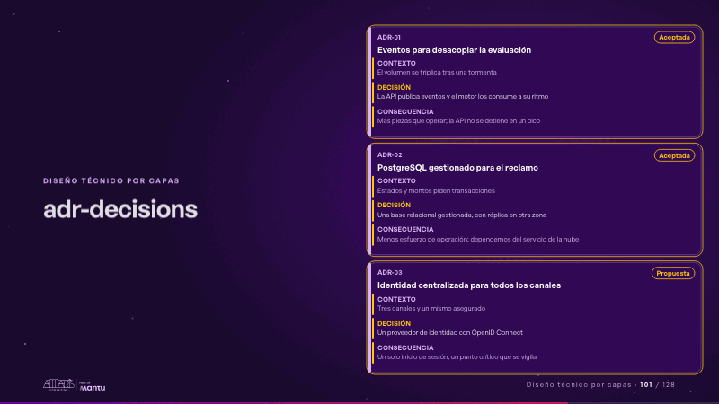
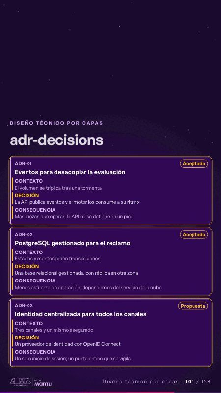

# adr-decisions · Diseño técnico por capas

 

## Qué cuenta

Tres tarjetas de decisión, cada una con su contexto, su decisión, su consecuencia y su estado.

## Cómo respira

Cada tarjeta se enciende por turno: primero el contexto, luego la decisión y al final la consecuencia; su estado se sella.

## Cuándo usarla

Intención: **Diseño técnico por capas** (architecture, criterion). Verticales: cualquiera. Layout `left`. Origen: Arquitectura demo (Aseguradora Andina, ficticia) · diapositiva «Tres decisiones que tomamos y lo que cuestan». El snippet completo, listo para pegar en un storyboard: [`snippets/adr-decisions.json`](../../snippets/adr-decisions.json).

## Args

```json
{
 "layout": "left",
 "scene": "adr-decisions",
 "args": {
  "decisions": [
   [
    "‹como: ADR-01›",
    "‹como: Eventos para desacoplar la evaluación›",
    "‹como: El volumen se triplica tras una tormenta›",
    "‹como: La API publica eventos y el motor los consume a su ritmo›",
    "‹como: Más piezas que operar; la API no se detiene en un pico›",
    "‹como: Aceptada›"
   ],
   [
    "‹como: ADR-02›",
    "‹como: PostgreSQL gestionado para el reclamo›",
    "‹como: Estados y montos piden transacciones›",
    "‹como: Una base relacional gestionada, con réplica en otra zona›",
    "‹como: Menos esfuerzo de operación; dependemos del servicio de la nube›",
    "‹como: Aceptada›"
   ],
   [
    "‹como: ADR-03›",
    "‹como: Identidad centralizada para todos los canales›",
    "‹como: Tres canales y un mismo asegurado›",
    "‹como: Un proveedor de identidad con OpenID Connect›",
    "‹como: Un solo inicio de sesión; un punto crítico que se vigila›",
    "‹como: Propuesta›"
   ]
  ]
 }
}
```

## What it is

Layered technical design scene, layout «left», for any decks. It lands at a glance, then breathes in a slow loop; its args (decisions) carry every visible word, so the same scene serves a new client once the texts are rewritten.

## Relacionadas · Related

- [arq-hero · Portada: su promesa](arq-hero.md)
- [automation-stairs · El mecanismo: cómo cambiaría su operación](automation-stairs.md)
- [c4-code · Diseño técnico por capas](c4-code.md)
- [c4-component · Diseño técnico por capas](c4-component.md)
- [c4-container · Diseño técnico por capas](c4-container.md)
- [c4-context · Diseño técnico por capas](c4-context.md)

Fuente · source: [`scenes/story/arquitectura.py`](../../scenes/story/arquitectura.py) · sha256 `01c6a4b3e10f`
