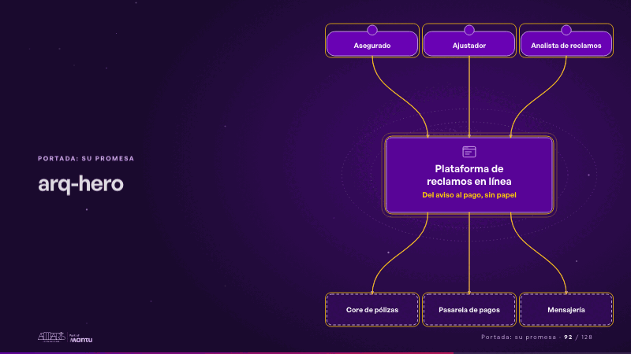
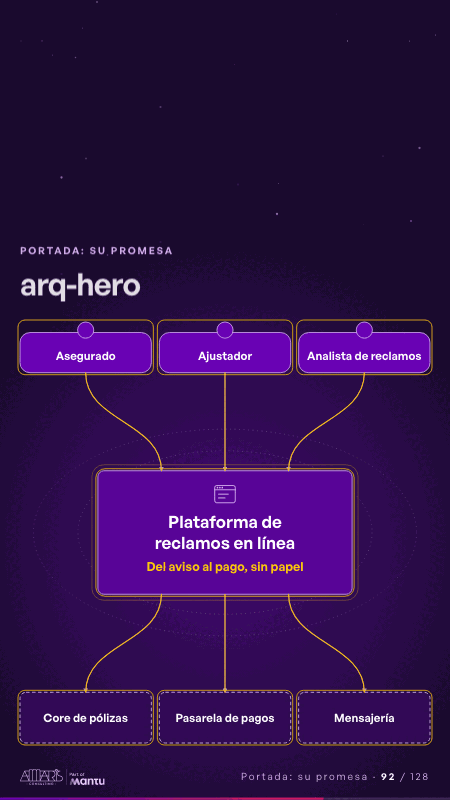

# arq-hero · Portada: su promesa

 

## Qué cuenta

La plataforma en el centro; a la izquierda, quienes la usan; a la derecha, los sistemas con los que conversa.

## Cómo respira

Una solicitud sale de cada persona, cruza la plataforma y llega a un sistema externo; cada uno se enciende al recibirla.

## Cuándo usarla

Intención: **Portada: su promesa** (hero, architecture). Verticales: cualquiera. Layout `left`. Origen: Arquitectura demo (Aseguradora Andina, ficticia) · diapositiva «Reclamos resueltos en línea, de principio a fin». El snippet completo, listo para pegar en un storyboard: [`snippets/arq-hero.json`](../../snippets/arq-hero.json).

## Args

```json
{
 "layout": "left",
 "scene": "arq-hero",
 "args": {
  "system": "‹como: Plataforma de reclamos en línea›",
  "promise": "‹como: Del aviso al pago, sin papel›",
  "actors": [
   "‹como: Asegurado›",
   "‹como: Ajustador›",
   "‹como: Analista de reclamos›"
  ],
  "systems": [
   "‹como: Core de pólizas›",
   "‹como: Pasarela de pagos›",
   "‹como: Mensajería›"
  ]
 }
}
```

## What it is

Cover: their promise scene, layout «left», for any decks. It lands at a glance, then breathes in a slow loop; its args (actors, promise, system, systems) carry every visible word, so the same scene serves a new client once the texts are rewritten.

## Relacionadas · Related

- [adr-decisions · Diseño técnico por capas](adr-decisions.md)
- [automation-stairs · El mecanismo: cómo cambiaría su operación](automation-stairs.md)
- [c4-code · Diseño técnico por capas](c4-code.md)
- [c4-component · Diseño técnico por capas](c4-component.md)
- [c4-container · Diseño técnico por capas](c4-container.md)
- [c4-context · Diseño técnico por capas](c4-context.md)

Fuente · source: [`scenes/story/arquitectura.py`](../../scenes/story/arquitectura.py) · sha256 `01c6a4b3e10f`
