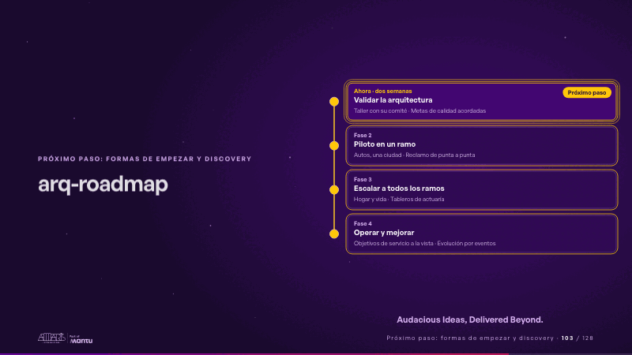
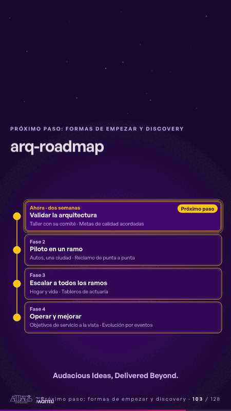

# arq-roadmap · Próximo paso: formas de empezar y discovery

 

## Qué cuenta

Cuatro fases en una línea de tiempo; la primera, validar la arquitectura, marcada como próximo paso.

## Cómo respira

Un punto recorre las fases y cada una se enciende; la primera queda con su anillo de próximo paso.

## Cuándo usarla

Intención: **Próximo paso: formas de empezar y discovery** (cta, vision). Verticales: cualquiera. Layout `left`. Origen: Arquitectura demo (Aseguradora Andina, ficticia) · diapositiva «Cada reclamo, resuelto en línea y a tiempo». El snippet completo, listo para pegar en un storyboard: [`snippets/arq-roadmap.json`](../../snippets/arq-roadmap.json).

## Args

```json
{
 "layout": "left",
 "scene": "arq-roadmap",
 "args": {
  "phases": [
   [
    "‹como: Validar la arquitectura›",
    "‹como: Ahora · dos semanas›",
    [
     "‹como: Taller con su comité›",
     "‹como: Metas de calidad acordadas›"
    ]
   ],
   [
    "‹como: Piloto en un ramo›",
    "‹como: Fase 2›",
    [
     "‹como: Autos, una ciudad›",
     "‹como: Reclamo de punta a punta›"
    ]
   ],
   [
    "‹como: Escalar a todos los ramos›",
    "‹como: Fase 3›",
    [
     "‹como: Hogar y vida›",
     "‹como: Tableros de actuaría›"
    ]
   ],
   [
    "‹como: Operar y mejorar›",
    "‹como: Fase 4›",
    [
     "‹como: Objetivos de servicio a la vista›",
     "‹como: Evolución por eventos›"
    ]
   ]
  ],
  "now": 0,
  "next": "‹como: Próximo paso›",
  "sign": "‹como: Audacious Ideas, Delivered Beyond.›"
 }
}
```

## What it is

Next step scene, layout «left», for any decks. It lands at a glance, then breathes in a slow loop; its args (next, now, phases, sign) carry every visible word, so the same scene serves a new client once the texts are rewritten.

## Relacionadas · Related

- [simple-next · Próximo paso: formas de empezar y discovery](simple-next.md)
- [capacity-join · La prueba y la evidencia](capacity-join.md)
- [care-center · Cierre: su futuro, funcionando (el lema)](care-center.md)
- [controlroom-live · Cierre: su futuro, funcionando (el lema)](controlroom-live.md)
- [discovery · Próximo paso: formas de empezar y discovery](discovery.md)
- [discovery-b · Próximo paso: formas de empezar y discovery](discovery-b.md)

Fuente · source: [`scenes/story/arquitectura.py`](../../scenes/story/arquitectura.py) · sha256 `01c6a4b3e10f`
