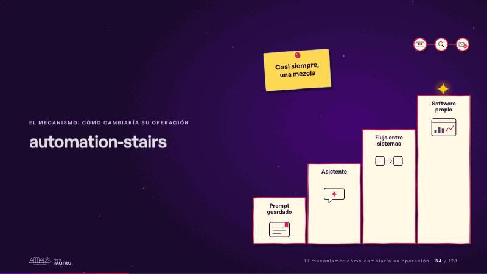
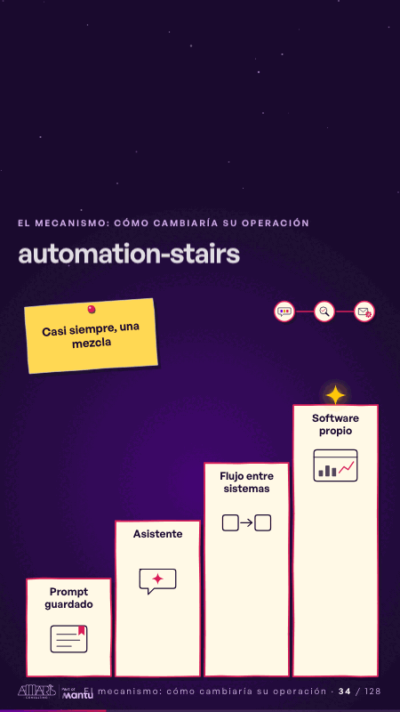

# automation-stairs · El mecanismo: cómo cambiaría su operación

 

## Qué cuenta

Una escalera de cuatro peldaños de papel y, en la esquina, el mapa de la estrategia con dos paradas recorridas.

## Cómo respira

Una chispa sube los peldaños (prompt guardado, asistente, flujo entre sistemas, software propio) y cada uno se enciende con borde magenta y queda encendido; se enciende la tercera parada del mapa y se clava la nota «casi siempre, una mezcla». Cuadro final: los cuatro peldaños encendidos y la nota.

## Cuándo usarla

Intención: **El mecanismo: cómo cambiaría su operación** (process, architecture). Verticales: cualquiera. Layout `left`; mundo papel. Origen: dcd · escena de catálogo (fidelización). El snippet completo, listo para pegar en un storyboard: [`snippets/automation-stairs.json`](../../snippets/automation-stairs.json).

## Args

```json
{
 "layout": "left",
 "scene": "automation-stairs",
 "args": {
  "steps": [
   "‹como: Prompt guardado›",
   "‹como: Asistente›",
   "‹como: Flujo entre sistemas›",
   "‹como: Software propio›"
  ],
  "note": "‹como: Casi siempre, una mezcla›"
 }
}
```

## What it is

The mechanism scene, layout «left», for any decks. It lands at a glance, then breathes in a slow loop; its args (note, steps) carry every visible word, so the same scene serves a new client once the texts are rewritten.

## Relacionadas · Related

- [luz-ladder · Diseño técnico por capas](luz-ladder.md)
- [solution-layers · Diseño técnico por capas](solution-layers.md)
- [adr-decisions · Diseño técnico por capas](adr-decisions.md)
- [arq-hero · Portada: su promesa](arq-hero.md)
- [before-after-lanes · Antes y después](before-after-lanes.md)
- [before-after-split · Antes y después](before-after-split.md)

Fuente · source: [`scenes/story/fidelizacion_s01_15.py`](../../scenes/story/fidelizacion_s01_15.py) · sha256 `c89653556c57`
