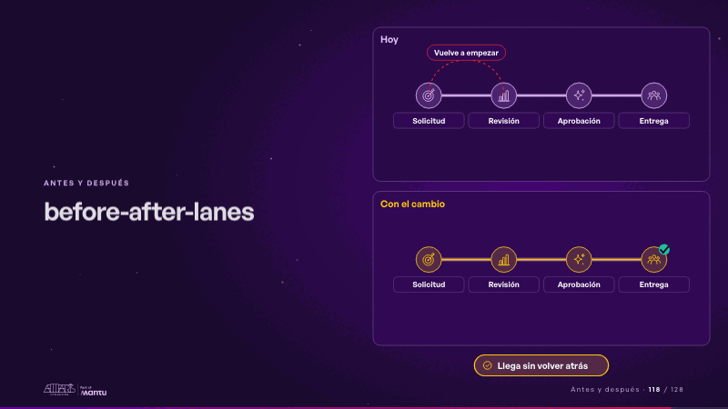
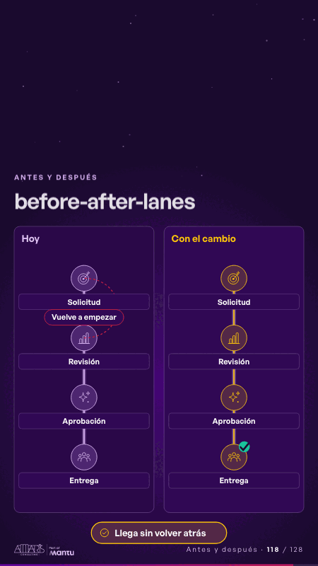

# before-after-lanes · Antes y después

 

## Qué cuenta

Dos carriles con las mismas cuatro estaciones y los íconos de su sector: «Hoy», con una vuelta atrás marcada, y «Con el cambio», derecho; abajo, el resultado.

## Cómo respira

En el carril de hoy, la ficha vuelve de la segunda estación a la primera y después sigue; en el nuevo, corre derecho y llega primero, recibe su visto y se enciende el resultado. Queda: los dos carriles recorridos, el nuevo con su visto.

## Cuándo usarla

Intención: **Antes y después** (before-after, process). Verticales: cualquiera. Layout `left`. Origen: dcd 0.6.0 · escena de catálogo. El snippet completo, listo para pegar en un storyboard: [`snippets/before-after-lanes.json`](../../snippets/before-after-lanes.json).

## Args

```json
{
 "layout": "left",
 "scene": "before-after-lanes",
 "args": {
  "steps": [
   "‹como: Solicitud›",
   "‹como: Revisión›",
   "‹como: Aprobación›",
   "‹como: Entrega›"
  ],
  "before_label": "‹como: Hoy›",
  "after_label": "‹como: Con el cambio›",
  "detour": "‹como: Vuelve a empezar›",
  "result": "‹como: Llega sin volver atrás›"
 }
}
```

## What it is

Before and after scene, layout «left», for any decks. It lands at a glance, then breathes in a slow loop; its args (after_label, before_label, detour, result, steps) carry every visible word, so the same scene serves a new client once the texts are rewritten.

## Relacionadas · Related

- [before-after-split · Antes y después](before-after-split.md)
- [automation-stairs · El mecanismo: cómo cambiaría su operación](automation-stairs.md)
- [build-deliver · Formación: la demo en vivo](build-deliver.md)
- [delivery-cycle · El mecanismo: cómo cambiaría su operación](delivery-cycle.md)
- [discovery · Próximo paso: formas de empezar y discovery](discovery.md)
- [discovery-b · Próximo paso: formas de empezar y discovery](discovery-b.md)

Fuente · source: [`scenes/story/intents_s01_08.py`](../../scenes/story/intents_s01_08.py) · sha256 `40167e45ae96`
