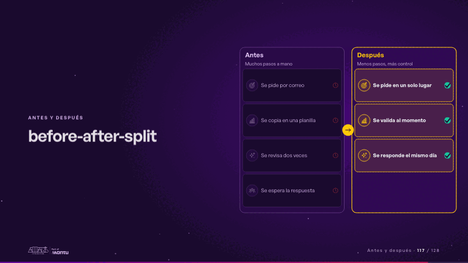
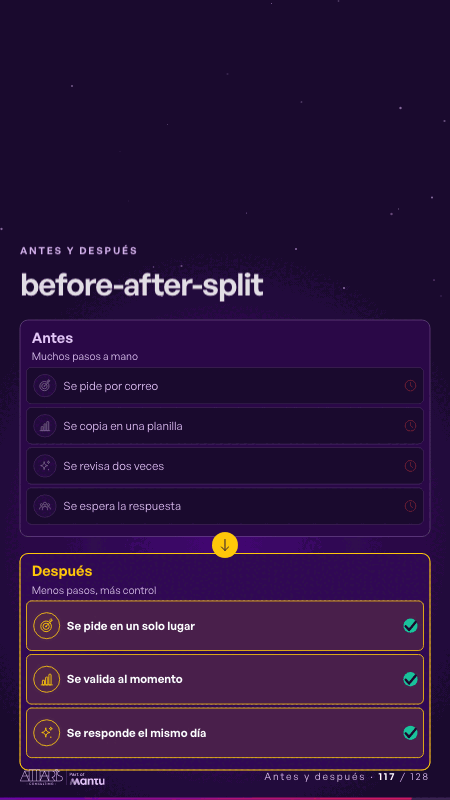

# before-after-split · Antes y después

 

## Qué cuenta

Dos paneles: «Antes», con cuatro pasos a mano y su reloj, y «Después», punteado, con tres pasos por encender.

## Cómo respira

Una línea barre del panel de antes al de después: los pasos viejos se apagan uno a uno y los nuevos se encienden con su visto. Queda: antes, tenue; después, encendido.

## Cuándo usarla

Intención: **Antes y después** (before-after, gap, process). Verticales: cualquiera. Layout `left`. Origen: dcd 0.6.0 · escena de catálogo. El snippet completo, listo para pegar en un storyboard: [`snippets/before-after-split.json`](../../snippets/before-after-split.json).

## Args

```json
{
 "layout": "left",
 "scene": "before-after-split",
 "args": {
  "before_label": "‹como: Antes›",
  "before_note": "‹como: Muchos pasos a mano›",
  "before": [
   "‹como: Se pide por correo›",
   "‹como: Se copia en una planilla›",
   "‹como: Se revisa dos veces›",
   "‹como: Se espera la respuesta›"
  ],
  "after_label": "‹como: Después›",
  "after_note": "‹como: Menos pasos, más control›",
  "after": [
   "‹como: Se pide en un solo lugar›",
   "‹como: Se valida al momento›",
   "‹como: Se responde el mismo día›"
  ]
 }
}
```

## What it is

Before and after scene, layout «left», for any decks. It lands at a glance, then breathes in a slow loop; its args (after, after_label, after_note, before, before_label, before_note) carry every visible word, so the same scene serves a new client once the texts are rewritten.

## Relacionadas · Related

- [before-after-lanes · Antes y después](before-after-lanes.md)
- [journey-path · Recorrido](journey-path.md)
- [automation-stairs · El mecanismo: cómo cambiaría su operación](automation-stairs.md)
- [build-deliver · Formación: la demo en vivo](build-deliver.md)
- [cascade · La brecha: su idea y lo que pasa cuando no se cumple](cascade.md)
- [client-worries · La brecha: su idea y lo que pasa cuando no se cumple](client-worries.md)

Fuente · source: [`scenes/story/intents_s01_08.py`](../../scenes/story/intents_s01_08.py) · sha256 `40167e45ae96`
