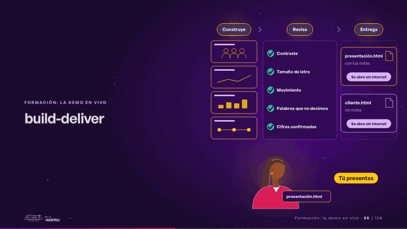
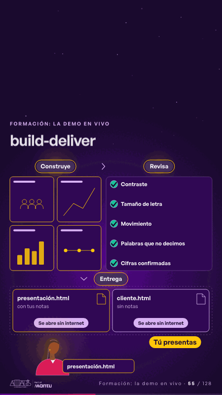

# build-deliver · Formación: la demo en vivo

 

## Qué cuenta

Tres columnas de izquierda a derecha: «Construye» con cuatro diapositivas vacías, «Revisa» con cinco revisiones apagadas y «Entrega», una bandeja vacía.

## Cómo respira

Las diapositivas se llenan con su escena; una línea baja por «Contraste», «Tamaño de letra», «Movimiento», «Palabras que no decimos» y «Cifras confirmadas», que se ponen en verde; caen «presentación.html · con tus notas» y «cliente.html · sin notas», cada uno «Se abre sin internet», y una persona da un paso al frente con el archivo: «Tú presentas».

## Cuándo usarla

Intención: **Formación: la demo en vivo** (demo, process). Verticales: formacion. Layout `left`. Origen: Clase VR (formación) · diapositiva «El skill construye, revisa y entrega; tú presentas». El snippet completo, listo para pegar en un storyboard: [`snippets/build-deliver.json`](../../snippets/build-deliver.json).

## Args

```json
{
 "layout": "left",
 "scene": "build-deliver",
 "args": {
  "phases": [
   "‹como: Construye›",
   "‹como: Revisa›",
   "‹como: Entrega›"
  ],
  "checks": [
   "‹como: Contraste›",
   "‹como: Tamaño de letra›",
   "‹como: Movimiento›",
   "‹como: Palabras que no decimos›",
   "‹como: Cifras confirmadas›"
  ],
  "files": [
   [
    "‹como: presentación.html›",
    "‹como: con tus notas›"
   ],
   [
    "‹como: cliente.html›",
    "‹como: sin notas›"
   ]
  ],
  "offline": "‹como: Se abre sin internet›",
  "you": "‹como: Tú presentas›"
 }
}
```

## What it is

Training: live demo scene, layout «left», for formacion decks. It lands at a glance, then breathes in a slow loop; its args (checks, files, offline, phases, you) carry every visible word, so the same scene serves a new client once the texts are rewritten.

## Relacionadas · Related

- [live-steps · Formación: la demo en vivo](live-steps.md)
- [mirroring · El mecanismo: cómo cambiaría su operación](mirroring.md)
- [skill-handoff · Formación: la demo en vivo](skill-handoff.md)
- [titles-thread · El mecanismo: cómo cambiaría su operación](titles-thread.md)
- [two-seconds · El mecanismo: cómo cambiaría su operación](two-seconds.md)
- [automation-stairs · El mecanismo: cómo cambiaría su operación](automation-stairs.md)

Fuente · source: [`scenes/story/formacion_s16_18.py`](../../scenes/story/formacion_s16_18.py) · sha256 `68e8f494ee34`
