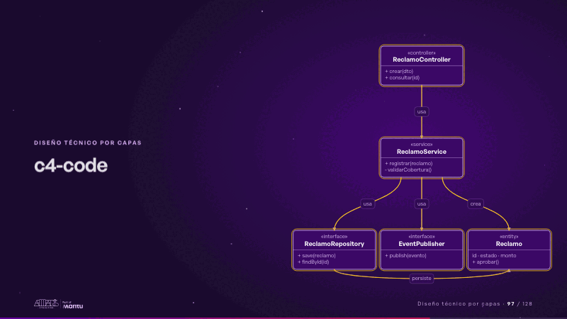
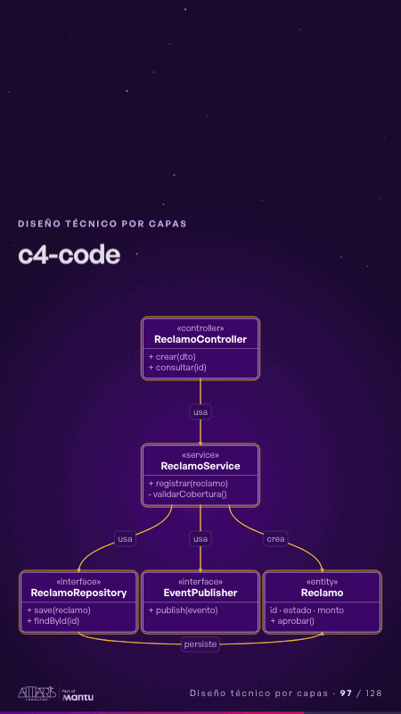

# c4-code · Diseño técnico por capas

 

## Qué cuenta

Cinco clases: el controlador arriba, el servicio al centro y, abajo, dos interfaces y la entidad del reclamo.

## Cómo respira

La llamada baja del controlador al servicio y de ahí a cada interfaz y a la entidad; cada clase se enciende al usarse.

## Cuándo usarla

Intención: **Diseño técnico por capas** (architecture). Verticales: cualquiera. Layout `left`. Origen: Arquitectura demo (Aseguradora Andina, ficticia) · diapositiva «El código del núcleo: clases y dependencias del reclamo». El snippet completo, listo para pegar en un storyboard: [`snippets/c4-code.json`](../../snippets/c4-code.json).

## Args

```json
{
 "layout": "left",
 "scene": "c4-code",
 "args": {
  "classes": [
   [
    "‹como: ctrl›",
    "‹como: ReclamoController›",
    "‹como: controller›",
    [
     "‹como: + crear(dto)›",
     "‹como: + consultar(id)›"
    ]
   ],
   [
    "‹como: svc›",
    "‹como: ReclamoService›",
    "‹como: service›",
    [
     "‹como: + registrar(reclamo)›",
     "‹como: - validarCobertura()›"
    ]
   ],
   [
    "‹como: repo›",
    "‹como: ReclamoRepository›",
    "‹como: interface›",
    [
     "‹como: + save(reclamo)›",
     "‹como: + findById(id)›"
    ]
   ],
   [
    "‹como: pub›",
    "‹como: EventPublisher›",
    "‹como: interface›",
    [
     "‹como: + publish(evento)›"
    ]
   ],
   [
    "‹como: ent›",
    "‹como: Reclamo›",
    "‹como: entity›",
    [
     "‹como: id · estado · monto›",
     "‹como: + aprobar()›"
    ]
   ]
  ],
  "rels": [
   [
    "‹como: ctrl›",
    "‹como: svc›",
    "‹como: usa›"
   ],
   [
    "‹como: svc›",
    "‹como: repo›",
    "‹como: usa›"
   ],
   [
    "‹como: svc›",
    "‹como: pub›",
    "‹como: usa›"
   ],
   [
    "‹como: svc›",
    "‹como: ent›",
    "‹como: crea›"
   ],
   [
    "‹como: repo›",
    "‹como: ent›",
    "‹como: persiste›"
   ]
  ]
 }
}
```

## What it is

Layered technical design scene, layout «left», for any decks. It lands at a glance, then breathes in a slow loop; its args (classes, rels) carry every visible word, so the same scene serves a new client once the texts are rewritten.

## Relacionadas · Related

- [adr-decisions · Diseño técnico por capas](adr-decisions.md)
- [arq-hero · Portada: su promesa](arq-hero.md)
- [automation-stairs · El mecanismo: cómo cambiaría su operación](automation-stairs.md)
- [c4-component · Diseño técnico por capas](c4-component.md)
- [c4-container · Diseño técnico por capas](c4-container.md)
- [c4-context · Diseño técnico por capas](c4-context.md)

Fuente · source: [`scenes/story/arquitectura.py`](../../scenes/story/arquitectura.py) · sha256 `01c6a4b3e10f`
