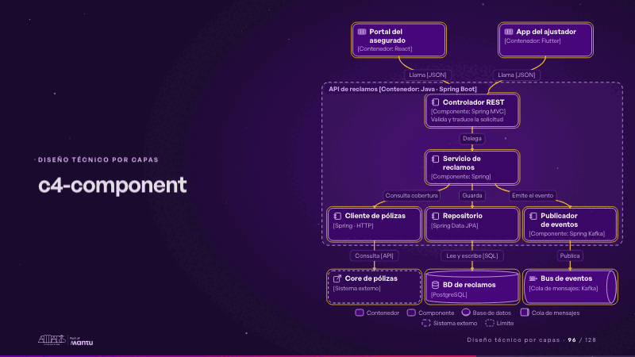
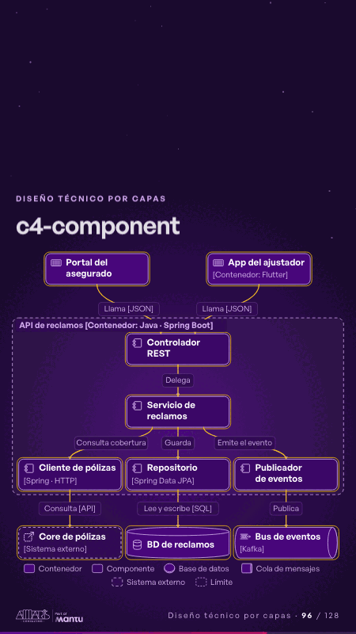

# c4-component · Diseño técnico por capas

 

## Qué cuenta

El recuadro de la API con cinco componentes en tres niveles; arriba, el portal y la app; abajo, el core, la base de datos y el bus.

## Cómo respira

La solicitud baja del controlador al servicio y se abre en tres: cobertura, persistencia y evento; cada componente se enciende al recibirla.

## Cuándo usarla

Intención: **Diseño técnico por capas** (architecture). Verticales: cualquiera. Layout `left`. Origen: Arquitectura demo (Aseguradora Andina, ficticia) · diapositiva «Dentro de la API: cinco componentes con una sola responsabilidad». El snippet completo, listo para pegar en un storyboard: [`snippets/c4-component.json`](../../snippets/c4-component.json).

## Args

```json
{
 "layout": "left",
 "scene": "c4-component",
 "args": {
  "boundary": "‹como: API de reclamos [Contenedor: Java · Spring Boot]›",
  "inputs": [
   [
    "‹como: web›",
    "‹como: Portal del asegurado›",
    "‹como: React›",
    "",
    "‹como: web›"
   ],
   [
    "‹como: app›",
    "‹como: App del ajustador›",
    "‹como: Flutter›",
    "",
    "‹como: app›"
   ]
  ],
  "components": [
   [
    "‹como: ctrl›",
    "‹como: Controlador REST›",
    "‹como: Spring MVC›",
    "‹como: Valida y traduce la solicitud›"
   ],
   [
    "‹como: svc›",
    "‹como: Servicio de reclamos›",
    "‹como: Spring›",
    "‹como: Reglas y estados›"
   ],
   [
    "‹como: cob›",
    "‹como: Cliente de pólizas›",
    "‹como: Spring · HTTP›",
    ""
   ],
   [
    "‹como: repo›",
    "‹como: Repositorio›",
    "‹como: Spring Data JPA›",
    ""
   ],
   [
    "‹como: pub›",
    "‹como: Publicador de eventos›",
    "‹como: Spring Kafka›",
    ""
   ]
  ],
  "outputs": [
   [
    "‹como: core›",
    "‹como: Core de pólizas›",
    "",
    "",
    "‹como: external›"
   ],
   [
    "‹como: db›",
    "‹como: BD de reclamos›",
    "‹como: PostgreSQL›",
    "",
    "‹como: db›"
   ],
   [
    "‹como: bus›",
    "‹como: Bus de eventos›",
    "‹como: Kafka›",
    "",
    "‹como: queue›"
   ]
  ],
  "rels": [
   [
    "‹como: web›",
    "‹como: ctrl›",
    "‹como: Llama›",
    "‹como: JSON›"
   ],
   [
    "‹como: app›",
    "‹como: ctrl›",
    "‹como: Llama›",
    "‹como: JSON›"
   ],
   [
    "‹como: ctrl›",
    "‹como: svc›",
    "‹como: Delega›",
    ""
   ],
   [
    "‹como: svc›",
    "‹como: cob›",
    "‹como: Consulta cobertura›",
    ""
   ],
   [
    "‹como: svc›",
    "‹como: repo›",
    "‹como: Guarda›",
    ""
   ],
   [
    "‹como: svc›",
    "‹como: pub›",
    "‹como: Emite el evento›",
    ""
   ],
   [
    "‹como: cob›",
    "‹como: core›",
    "‹como: Consulta›",
    "‹como: API›"
   ],
   [
    "‹como: repo›",
    "‹como: db›",
    "‹como: Lee y escribe›",
    "‹como: SQL›"
   ],
   [
    "‹como: pub›",
    "‹como: bus›",
    "‹como: Publica›",
    ""
   ]
  ]
 }
}
```

## What it is

Layered technical design scene, layout «left», for any decks. It lands at a glance, then breathes in a slow loop; its args (boundary, components, inputs, outputs, rels) carry every visible word, so the same scene serves a new client once the texts are rewritten.

## Relacionadas · Related

- [adr-decisions · Diseño técnico por capas](adr-decisions.md)
- [arq-hero · Portada: su promesa](arq-hero.md)
- [automation-stairs · El mecanismo: cómo cambiaría su operación](automation-stairs.md)
- [c4-code · Diseño técnico por capas](c4-code.md)
- [c4-container · Diseño técnico por capas](c4-container.md)
- [c4-context · Diseño técnico por capas](c4-context.md)

Fuente · source: [`scenes/story/arquitectura.py`](../../scenes/story/arquitectura.py) · sha256 `01c6a4b3e10f`
