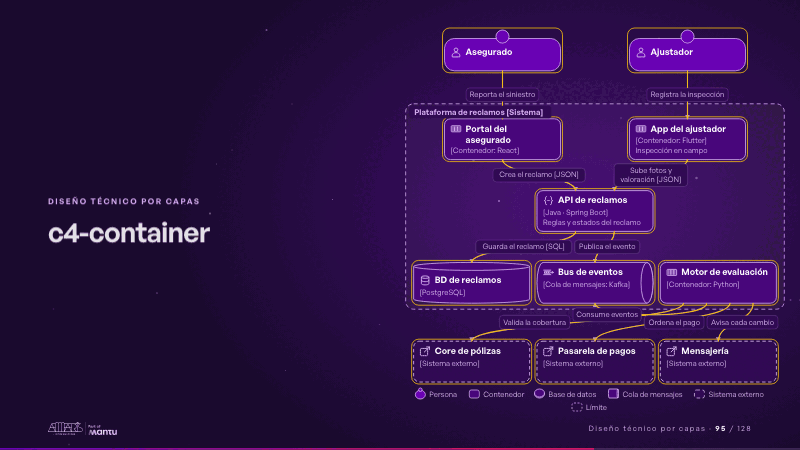
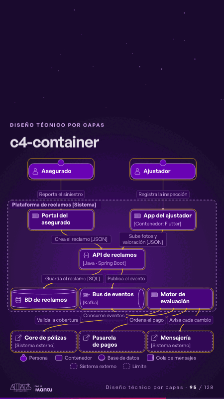

# c4-container · Diseño técnico por capas

 

## Qué cuenta

El recuadro de la plataforma con seis contenedores: portal, app, API, base de datos, bus de eventos y motor; fuera, personas y sistemas externos.

## Cómo respira

El reclamo entra por el portal, la API lo guarda y publica un evento; el motor lo consume, valida la cobertura, ordena el pago y avisa.

## Cuándo usarla

Intención: **Diseño técnico por capas** (architecture). Verticales: cualquiera. Layout `left`. Origen: Arquitectura demo (Aseguradora Andina, ficticia) · diapositiva «Seis contenedores que se despliegan y escalan por separado». El snippet completo, listo para pegar en un storyboard: [`snippets/c4-container.json`](../../snippets/c4-container.json).

## Args

```json
{"layout": "left", "scene": "c4-container", "args": {"boundary": "‹como: Plataforma de reclamos [Sistema]›", "people": [["‹como: asegurado›", "‹como: Asegurado›", "", "", "‹como: person›"], ["‹como: ajustador›", "‹como: Ajustador›", "", "", "‹como: person›"]], "containers": [["‹como: web›", "‹como: Portal del asegurado›", "‹como: React›", "‹como: Aviso y seguimiento›", "‹como: web›"], ["‹como: app›", "‹como: App del ajustador›", "‹como: Flutter›", "‹como: Inspección en campo›", "‹como: app›"], ["‹como: api›", "‹como: API de reclamos›", "‹como: Java · Spring Boot›", "‹como: Reglas y estados del reclamo›", "‹como: api›"], ["‹como: db›", "‹como: BD de reclamos›", "‹como: PostgreSQL›", "", "‹como: db›"], ["‹como: bus›", "‹como: Bus de eventos›", "‹como: Kafka›", "", "‹como: queue›"], ["‹como: motor›", "‹como: Motor de evaluación›", "‹como: Python›", "", "‹como: container›", 2]], "externals": [["‹como: core›", "‹como: Core de pólizas›", "", "", "‹como: external›"], ["‹como: pagos›", "‹como: Pasarela de pagos›", "", "", "‹como: external›"], ["‹como: mensajeria›", "‹como: Mensajería›", "", "", "‹como: external›"]], "rels": [["‹como: asegurado›", "‹como: web›", "‹como: Reporta el siniestro›", ""], ["‹como: ajustador›", "‹como: app›", "‹como: Registra la inspección›", ""], ["‹como: web›", "‹como: api›", "‹como: Crea el reclamo›", "‹como: JSON›"], ["‹como: app›", "‹como: api›", "‹como: Sube fotos y valoración›", "‹como: JSON›"], ["‹como: api›", "‹como: db›", "‹como: Guarda el reclamo›", "‹como: SQL›"], ["‹como: api›", "‹como: bus›", "‹como: Publica el evento›", ""], ["‹como: motor›", "‹como: bus›", "‹como: Consume eventos›", ""], ["‹como: motor›", "‹como: core›", "‹como: Valida la cobertura›", ""], ["‹como: motor›", "‹como: pagos›", "‹como: Ordena el pago›", ""], ["‹como: motor›", "‹como: mensajeria›", "‹como: Avisa cada cambio›", ""]]}}
```

## What it is

Layered technical design scene, layout «left», for any decks. It lands at a glance, then breathes in a slow loop; its args (boundary, containers, externals, people, rels) carry every visible word, so the same scene serves a new client once the texts are rewritten.

## Relacionadas · Related

- [adr-decisions · Diseño técnico por capas](adr-decisions.md)
- [arq-hero · Portada: su promesa](arq-hero.md)
- [automation-stairs · El mecanismo: cómo cambiaría su operación](automation-stairs.md)
- [c4-code · Diseño técnico por capas](c4-code.md)
- [c4-component · Diseño técnico por capas](c4-component.md)
- [c4-context · Diseño técnico por capas](c4-context.md)

Fuente · source: [`scenes/story/arquitectura.py`](../../scenes/story/arquitectura.py) · sha256 `01c6a4b3e10f`
