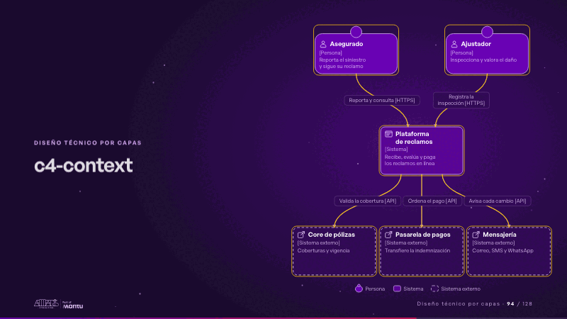
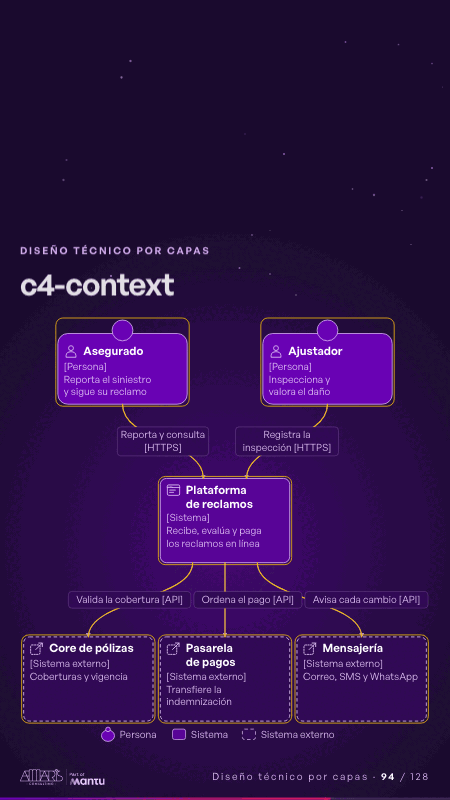

# c4-context · Diseño técnico por capas

 

## Qué cuenta

Arriba, el asegurado y el ajustador; al centro, la plataforma; abajo, tres sistemas externos; la leyenda C4 al pie.

## Cómo respira

Un reclamo baja de las personas a la plataforma y sale hacia el core, la pasarela y la mensajería; cada caja se enciende al recibirlo.

## Cuándo usarla

Intención: **Diseño técnico por capas** (architecture). Verticales: cualquiera. Layout `left`. Origen: Arquitectura demo (Aseguradora Andina, ficticia) · diapositiva «Contexto: quién usa la plataforma y con qué conversa». El snippet completo, listo para pegar en un storyboard: [`snippets/c4-context.json`](../../snippets/c4-context.json).

## Args

```json
{
 "layout": "left",
 "scene": "c4-context",
 "args": {
  "people": [
   [
    "‹como: asegurado›",
    "‹como: Asegurado›",
    "‹como: Reporta el siniestro y sigue su reclamo›"
   ],
   [
    "‹como: ajustador›",
    "‹como: Ajustador›",
    "‹como: Inspecciona y valora el daño›"
   ]
  ],
  "system": [
   "‹como: plataforma›",
   "‹como: Plataforma de reclamos›",
   "‹como: Recibe, evalúa y paga los reclamos en línea›"
  ],
  "externals": [
   [
    "‹como: core›",
    "‹como: Core de pólizas›",
    "‹como: Coberturas y vigencia›"
   ],
   [
    "‹como: pagos›",
    "‹como: Pasarela de pagos›",
    "‹como: Transfiere la indemnización›"
   ],
   [
    "‹como: mensajeria›",
    "‹como: Mensajería›",
    "‹como: Correo, SMS y WhatsApp›"
   ]
  ],
  "rels": [
   [
    "‹como: asegurado›",
    "‹como: plataforma›",
    "‹como: Reporta y consulta›",
    "‹como: HTTPS›"
   ],
   [
    "‹como: ajustador›",
    "‹como: plataforma›",
    "‹como: Registra la inspección›",
    "‹como: HTTPS›"
   ],
   [
    "‹como: plataforma›",
    "‹como: core›",
    "‹como: Valida la cobertura›",
    "‹como: API›"
   ],
   [
    "‹como: plataforma›",
    "‹como: pagos›",
    "‹como: Ordena el pago›",
    "‹como: API›"
   ],
   [
    "‹como: plataforma›",
    "‹como: mensajeria›",
    "‹como: Avisa cada cambio›",
    "‹como: API›"
   ]
  ]
 }
}
```

## What it is

Layered technical design scene, layout «left», for any decks. It lands at a glance, then breathes in a slow loop; its args (externals, people, rels, system) carry every visible word, so the same scene serves a new client once the texts are rewritten.

## Relacionadas · Related

- [adr-decisions · Diseño técnico por capas](adr-decisions.md)
- [arq-hero · Portada: su promesa](arq-hero.md)
- [automation-stairs · El mecanismo: cómo cambiaría su operación](automation-stairs.md)
- [c4-code · Diseño técnico por capas](c4-code.md)
- [c4-component · Diseño técnico por capas](c4-component.md)
- [c4-container · Diseño técnico por capas](c4-container.md)

Fuente · source: [`scenes/story/arquitectura.py`](../../scenes/story/arquitectura.py) · sha256 `01c6a4b3e10f`
