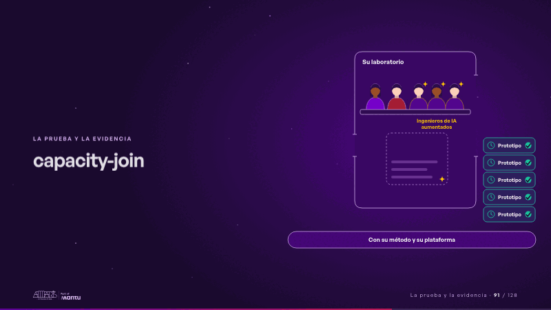
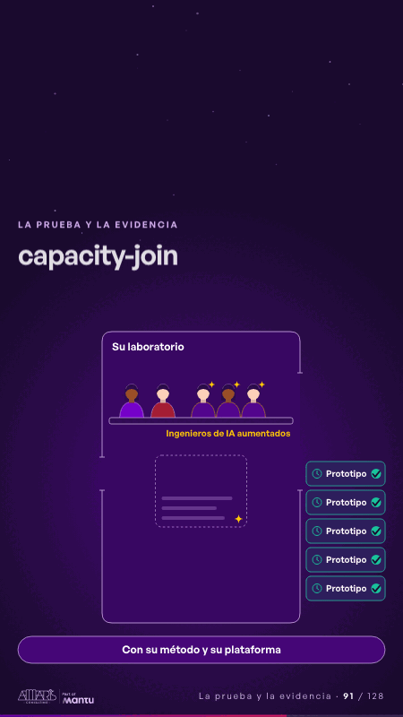

# capacity-join · La prueba y la evidencia

 

## Qué cuenta

A la izquierda, cinco solicitudes con su reloj esperan en la puerta de «Su laboratorio», donde trabajan dos personas; a la derecha, tres ingenieros de IA aumentados, cada uno con su chispa; debajo de todo, su método y su plataforma.

## Cómo respira

La primera solicitud empuja la puerta cerrada; los tres ingenieros entran por la derecha, la puerta se abre y la fila avanza: cada solicitud cruza el tablero del laboratorio y sale como prototipo con check y reloj en verde. Queda: la fila vacía, cinco prototipos afuera y cinco personas en el laboratorio.

## Cuándo usarla

Intención: **La prueba y la evidencia** (proof, cta). Verticales: cualquiera. Layout `left`. Origen: dcd · escena de catálogo (banca). El snippet completo, listo para pegar en un storyboard: [`snippets/capacity-join.json`](../../snippets/capacity-join.json).

## Args

```json
{
 "layout": "left",
 "scene": "capacity-join",
 "args": {
  "count": 5,
  "request": "‹como: Solicitud›",
  "proto": "‹como: Prototipo›",
  "lab": "‹como: Su laboratorio›",
  "engineers": "‹como: Ingenieros de IA aumentados›",
  "platform": "‹como: Con su método y su plataforma›"
 }
}
```

## What it is

Proof and evidence scene, layout «left», for any decks. It lands at a glance, then breathes in a slow loop; its args (count, engineers, lab, platform, proto, request) carry every visible word, so the same scene serves a new client once the texts are rewritten.

## Relacionadas · Related

- [proof-paths · La prueba y la evidencia](proof-paths.md)
- [arq-roadmap · Próximo paso: formas de empezar y discovery](arq-roadmap.md)
- [delivery-cycle · El mecanismo: cómo cambiaría su operación](delivery-cycle.md)
- [discovery · Próximo paso: formas de empezar y discovery](discovery.md)
- [discovery-b · Próximo paso: formas de empezar y discovery](discovery-b.md)
- [evidence · La prueba y la evidencia](evidence.md)

Fuente · source: [`scenes/story/banca_d07_10.py`](../../scenes/story/banca_d07_10.py) · sha256 `33beec2a7ad4`
