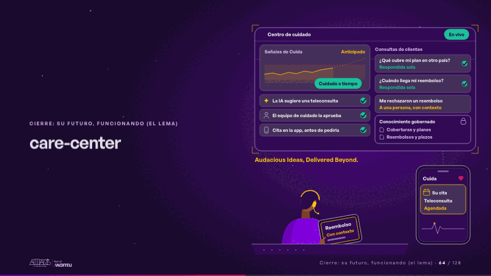
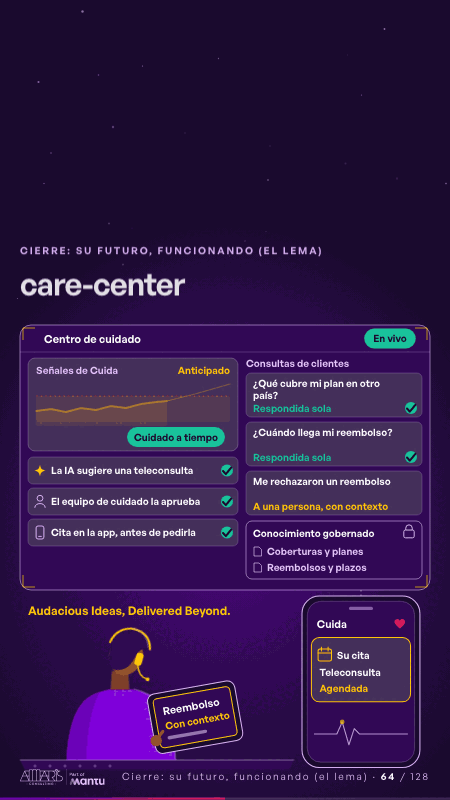

# care-center · Cierre: su futuro, funcionando (el lema)

 

## Qué cuenta

El centro de cuidado de mañana: la pantalla con las señales de Cuida y la cola de consultas, el teléfono del cliente con Cuida y, delante, una persona del equipo de cuidado con su tablet.

## Cómo respira

Un bucle de 12 segundos: la señal sube desde Cuida y se anticipa; la IA sugiere una teleconsulta, la persona la aprueba en la tablet y la cita llega a la app antes de que el cliente la pida; las dudas simples se responden solas desde el conocimiento gobernado y el reembolso rechazado baja a la persona, con su contexto.

## Cuándo usarla

Intención: **Cierre: su futuro, funcionando (el lema)** (vision). Verticales: salud. Layout `left`. Origen: dcd · escena de catálogo (salud). El snippet completo, listo para pegar en un storyboard: [`snippets/care-center.json`](../../snippets/care-center.json).

## Args

```json
{
 "layout": "left",
 "scene": "care-center",
 "args": {
  "screen": "‹como: Centro de cuidado›",
  "live": "‹como: En vivo›",
  "chart": "‹como: Señales de Cuida›",
  "forecast": "‹como: Anticipado›",
  "alert": "‹como: Señal anticipada›",
  "done": "‹como: Cuidado a tiempo›",
  "steps": [
   "‹como: La IA sugiere una teleconsulta›",
   "‹como: El equipo de cuidado la aprueba›",
   "‹como: Cita en la app, antes de pedirla›"
  ],
  "queue": "‹como: Consultas de clientes›",
  "tickets": [
   "‹como: ¿Qué cubre mi plan en otro país?›",
   "‹como: ¿Cuándo llega mi reembolso?›",
   "‹como: Me rechazaron un reembolso›"
  ],
  "new": "‹como: Nuevo›",
  "solved": "‹como: Respondida sola›",
  "sensitive": "‹como: Sensible›",
  "routed": "‹como: A una persona, con contexto›",
  "space": "‹como: Conocimiento gobernado›",
  "docs": [
   "‹como: Coberturas y planes›",
   "‹como: Reembolsos y plazos›"
  ],
  "app": "‹como: Cuida›",
  "note": [
   "‹como: Su cita›",
   "‹como: Teleconsulta›",
   "‹como: Agendada›"
  ],
  "approve": "‹como: Aprobar›",
  "case": [
   "‹como: Reembolso›",
   "‹como: Con contexto›"
  ],
  "sign": "‹como: Audacious Ideas, Delivered Beyond.›"
 }
}
```

## What it is

Closing: their future, working scene, layout «left», for salud decks. It lands at a glance, then breathes in a slow loop; its args (alert, app, approve, case, chart, docs, done, forecast, live, new, note, queue, routed, screen, sensitive, sign, solved, space, steps, tickets) carry every visible…

## Relacionadas · Related

- [discovery · Próximo paso: formas de empezar y discovery](discovery.md)
- [hero-care · Portada: su promesa](hero-care.md)
- [hypotheses-care · Hipótesis por validar](hypotheses-care.md)
- [repeat-story · La brecha: su idea y lo que pasa cuando no se cumple](repeat-story.md)
- [criterion · El criterio: retorno o habilitador](criterion.md)
- [outside-business · Desde afuera: lo que vimos en fuentes públicas](outside-business.md)

Fuente · source: [`scenes/story/salud_s07_14.py`](../../scenes/story/salud_s07_14.py) · sha256 `d97f63370815`
