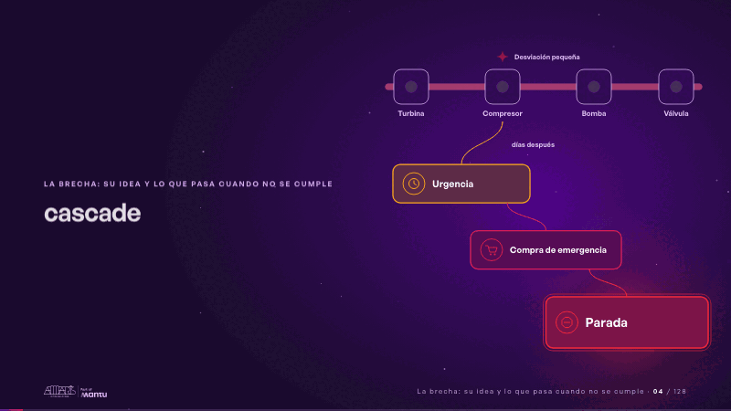
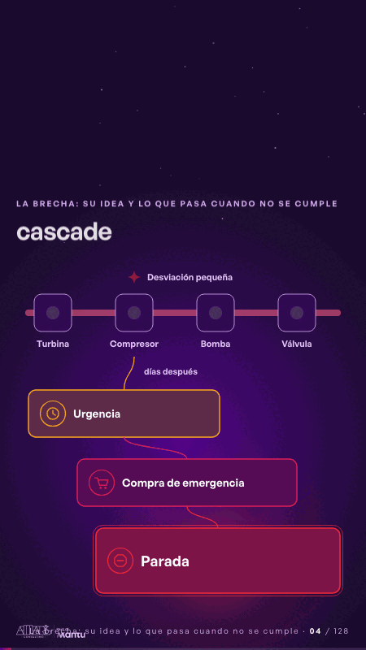

# cascade · La brecha: su idea y lo que pasa cuando no se cumple

 

## Qué cuenta

La línea de gas y sus cuatro equipos se arman; debajo esperan, apagados, los tres pasos de una cascada.

## Cómo respira

Una chispa en el compresor avisa y nadie la ve; días después se encienden la urgencia, la compra de emergencia y la parada, y el gas se detiene.

## Cuándo usarla

Intención: **La brecha: su idea y lo que pasa cuando no se cumple** (gap). Verticales: energia. Layout `left`. Origen: dcd · escena de catálogo (energía). El snippet completo, listo para pegar en un storyboard: [`snippets/cascade.json`](../../snippets/cascade.json).

## Args

```json
{
 "layout": "left",
 "scene": "cascade",
 "args": {
  "stations": [
   "‹como: Turbina›",
   "‹como: Compresor›",
   "‹como: Bomba›",
   "‹como: Válvula›"
  ],
  "small": "‹como: Desviación pequeña›",
  "gap": "‹como: días después›",
  "cascade": [
   "‹como: Urgencia›",
   "‹como: Compra de emergencia›",
   "‹como: Parada›"
  ]
 }
}
```

## What it is

The gap scene, layout «left», for energia decks. It lands at a glance, then breathes in a slow loop; its args (cascade, gap, small, stations) carry every visible word, so the same scene serves a new client once the texts are rewritten.

## Relacionadas · Related

- [hero · Portada: su promesa](hero.md)
- [hypotheses-live · Hipótesis por validar](hypotheses-live.md)
- [controlroom-live · Cierre: su futuro, funcionando (el lema)](controlroom-live.md)
- [discovery · Próximo paso: formas de empezar y discovery](discovery.md)
- [outside · Desde afuera: lo que vimos en fuentes públicas](outside.md)
- [criterion · El criterio: retorno o habilitador](criterion.md)

Fuente · source: [`scenes/story/energia_s04_06.py`](../../scenes/story/energia_s04_06.py) · sha256 `4361cd39f477`
