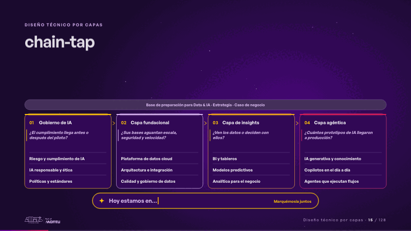
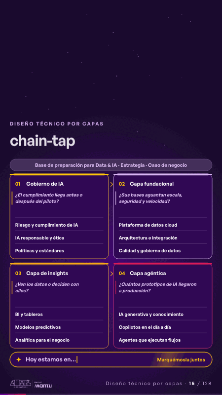

# chain-tap · Diseño técnico por capas

 

## Qué cuenta

Cuatro capas en cadena, cada una con su pregunta; abajo, un campo luminoso que escribe «Hoy estamos en…» y espera.

## Cómo respira

Un pulso recorre la cadena y el «?» enciende cada capa con su pregunta, luego la cadena entera se ilumina y el campo espera; al tocar la capa que nombren, se marca con «Hoy» y el campo responde «Empezamos por ahí».

## Cuándo usarla

Intención: **Diseño técnico por capas** (architecture, reflection). Verticales: cualquiera. Layout `top`. Origen: dcd · escena de catálogo (energía). El snippet completo, listo para pegar en un storyboard: [`snippets/chain-tap.json`](../../snippets/chain-tap.json).

## Args

```json
{
 "layout": "top",
 "scene": "chain-tap",
 "args": {
  "base": "‹como: Base de preparación para Data & IA · Estrategia · Caso de negocio›",
  "layers": [
   [
    "‹como: Gobierno de IA›",
    "‹como: ¿El cumplimiento llega antes o después del piloto?›",
    [
     "‹como: Riesgo y cumplimiento de IA›",
     "‹como: IA responsable y ética›",
     "‹como: Políticas y estándares›"
    ]
   ],
   [
    "‹como: Capa fundacional›",
    "‹como: ¿Sus bases aguantan escala, seguridad y velocidad?›",
    [
     "‹como: Plataforma de datos cloud›",
     "‹como: Arquitectura e integración›",
     "‹como: Calidad y gobierno de datos›"
    ]
   ],
   [
    "‹como: Capa de insights›",
    "‹como: ¿Ven los datos o deciden con ellos?›",
    [
     "‹como: BI y tableros›",
     "‹como: Modelos predictivos›",
     "‹como: Analítica para el negocio›"
    ]
   ],
   [
    "‹como: Capa agéntica›",
    "‹como: ¿Cuántos prototipos de IA llegaron a producción?›",
    [
     "‹como: IA generativa y conocimiento›",
     "‹como: Copilotos en el día a día›",
     "‹como: Agentes que ejecutan flujos›"
    ]
   ]
  ],
  "today": "‹como: Hoy›",
  "placeholder": "‹como: Hoy estamos en…›",
  "hint": "‹como: Marquémosla juntos›",
  "next": "‹como: Empezamos por ahí›",
  "answers": [
   "‹como: Hoy estamos en gobierno de IA›",
   "‹como: Hoy estamos en la capa fundacional›",
   "‹como: Hoy estamos en la capa de insights›",
   "‹como: Hoy estamos en la capa agéntica›"
  ]
 }
}
```

## What it is

Layered technical design scene, layout «top», for any decks. It lands at a glance, then breathes in a slow loop; its args (answers, base, hint, layers, next, placeholder, today) carry every visible word, so the same scene serves a new client once the texts are rewritten.

## Relacionadas · Related

- [discovery · Próximo paso: formas de empezar y discovery](discovery.md)
- [repeat-story · La brecha: su idea y lo que pasa cuando no se cumple](repeat-story.md)
- [hypotheses-live · Hipótesis por validar](hypotheses-live.md)
- [criterion · El criterio: retorno o habilitador](criterion.md)
- [tickets-live · Cierre: su futuro, funcionando (el lema)](tickets-live.md)
- [hypotheses-quarter · Portada: su promesa](hypotheses-quarter.md)

Fuente · source: [`scenes/story/energia_s13_15.py`](../../scenes/story/energia_s13_15.py) · sha256 `ee2c99a06c9a`
