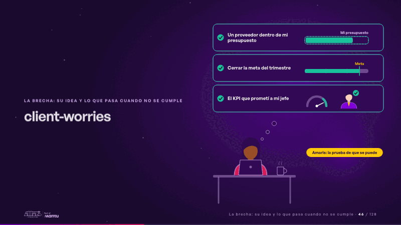
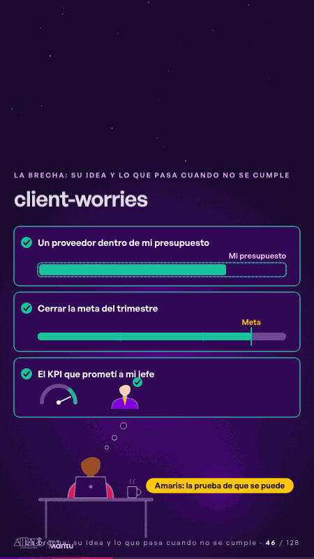

# client-worries · La brecha: su idea y lo que pasa cuando no se cumple

 

## Qué cuenta

Una manager sin rostro en su escritorio, detrás de su portátil; arriba aparece su primera preocupación, «Un proveedor dentro de mi presupuesto»; al lado, pequeño y apagado, el logo de Amaris.

## Cómo respira

Sus tres preocupaciones aparecen una a una y cada una se resuelve: la barra de la propuesta crece y cabe dentro de su presupuesto, la barra del trimestre toca la línea de la meta, la aguja del KPI entra en verde y su jefe recibe su visto. Solo al final se enciende Amaris: «Amaris: la prueba de que se puede».

## Cuándo usarla

Intención: **La brecha: su idea y lo que pasa cuando no se cumple** (gap, kpi). Verticales: formacion. Layout `left`. Origen: Clase VR (formación) · diapositiva «Al cliente le importa su meta del trimestre, no Amaris». El snippet completo, listo para pegar en un storyboard: [`snippets/client-worries.json`](../../snippets/client-worries.json).

## Args

```json
{
 "layout": "left",
 "scene": "client-worries",
 "args": {
  "worries": [
   "‹como: Un proveedor dentro de mi presupuesto›",
   "‹como: Cerrar la meta del trimestre›",
   "‹como: El KPI que prometí a mi jefe›"
  ],
  "budget": "‹como: Mi presupuesto›",
  "goal": "‹como: Meta›",
  "proof": "‹como: Amaris: la prueba de que se puede›"
 }
}
```

## What it is

The gap scene, layout «left», for formacion decks. It lands at a glance, then breathes in a slow loop; its args (budget, goal, proof, worries) carry every visible word, so the same scene serves a new client once the texts are rewritten.

## Relacionadas · Related

- [generic-template · La brecha: su idea y lo que pasa cuando no se cumple](generic-template.md)
- [kpi-card · KPI y casos de éxito](kpi-card.md)
- [week-calendar · La brecha: su idea y lo que pasa cuando no se cumple](week-calendar.md)
- [before-after-split · Antes y después](before-after-split.md)
- [cascade · La brecha: su idea y lo que pasa cuando no se cumple](cascade.md)
- [controlroom-live · Cierre: su futuro, funcionando (el lema)](controlroom-live.md)

Fuente · source: [`scenes/story/formacion_s04_06.py`](../../scenes/story/formacion_s04_06.py) · sha256 `b5c2493ae72d`
