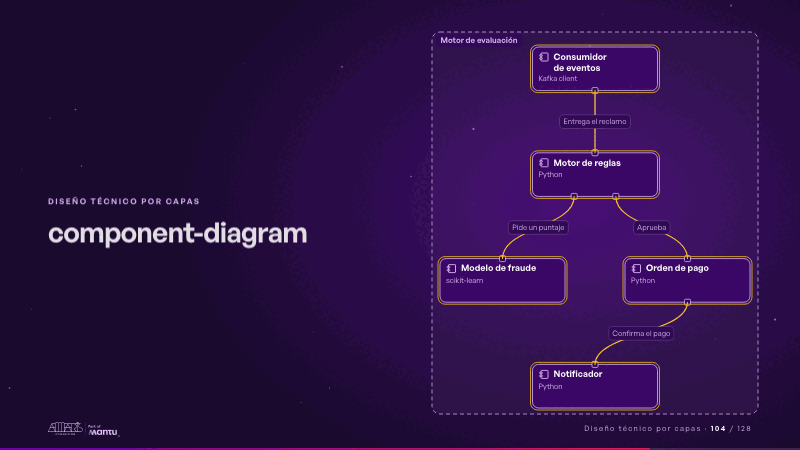
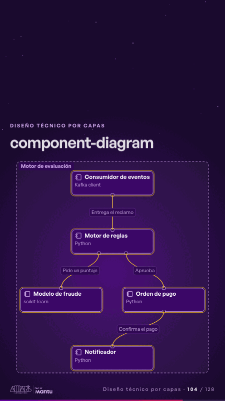

# component-diagram · Diseño técnico por capas

 

## Qué cuenta

Cajas con sus puertos, ordenadas por sus dependencias, dentro de un marco punteado; cada arista con su etiqueta.

## Cómo respira

Una solicitud recorre las aristas en orden: cada caja se enciende al recibirla y cada puerto la pasa a la siguiente.

## Cuándo usarla

Intención: **Diseño técnico por capas** (architecture). Verticales: cualquiera. Layout `left`. Origen: Arquitectura demo (Aseguradora Andina, ficticia) · ejemplo de references/architecture.md. El snippet completo, listo para pegar en un storyboard: [`snippets/component-diagram.json`](../../snippets/component-diagram.json).

## Args

```json
{
 "layout": "left",
 "scene": "component-diagram",
 "args": {
  "boundary": "‹como: Motor de evaluación›",
  "nodes": [
   [
    "‹como: cons›",
    "‹como: Consumidor de eventos›",
    "‹como: Kafka client›"
   ],
   [
    "‹como: reglas›",
    "‹como: Motor de reglas›",
    "‹como: Python›"
   ],
   [
    "‹como: fraude›",
    "‹como: Modelo de fraude›",
    "‹como: scikit-learn›"
   ],
   [
    "‹como: orden›",
    "‹como: Orden de pago›",
    "‹como: Python›"
   ],
   [
    "‹como: aviso›",
    "‹como: Notificador›",
    "‹como: Python›"
   ]
  ],
  "edges": [
   [
    "‹como: cons›",
    "‹como: reglas›",
    "‹como: Entrega el reclamo›"
   ],
   [
    "‹como: reglas›",
    "‹como: fraude›",
    "‹como: Pide un puntaje›"
   ],
   [
    "‹como: reglas›",
    "‹como: orden›",
    "‹como: Aprueba›"
   ],
   [
    "‹como: orden›",
    "‹como: aviso›",
    "‹como: Confirma el pago›"
   ]
  ]
 }
}
```

## What it is

Layered technical design scene, layout «left», for any decks. It lands at a glance, then breathes in a slow loop; its args (boundary, edges, nodes) carry every visible word, so the same scene serves a new client once the texts are rewritten.

## Relacionadas · Related

- [adr-decisions · Diseño técnico por capas](adr-decisions.md)
- [arq-hero · Portada: su promesa](arq-hero.md)
- [automation-stairs · El mecanismo: cómo cambiaría su operación](automation-stairs.md)
- [c4-code · Diseño técnico por capas](c4-code.md)
- [c4-component · Diseño técnico por capas](c4-component.md)
- [c4-container · Diseño técnico por capas](c4-container.md)

Fuente · source: [`scenes/story/arquitectura.py`](../../scenes/story/arquitectura.py) · sha256 `01c6a4b3e10f`
