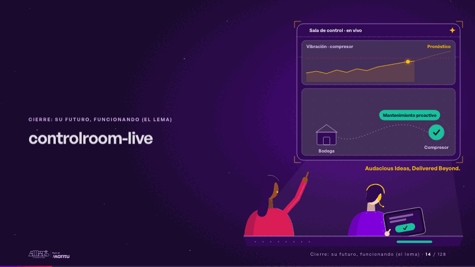
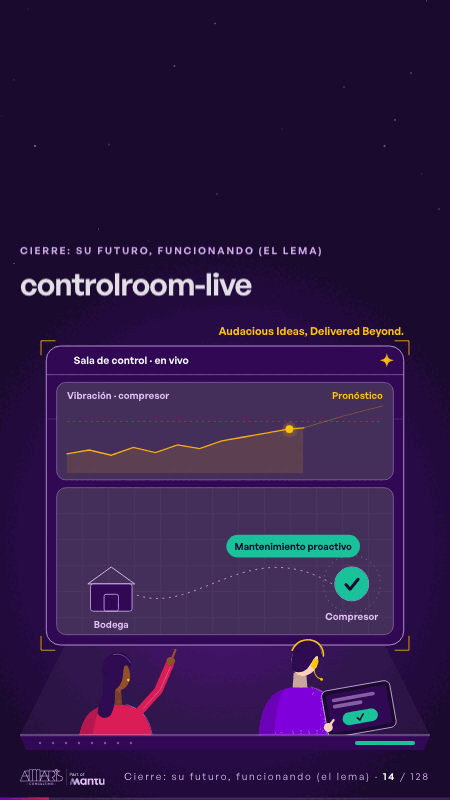

# controlroom-live · Cierre: su futuro, funcionando (el lema)

 

## Qué cuenta

El prototipo crece hasta la sala de control: la pantalla en vivo con el pronóstico y el mapa de bodega a estación; delante, dos operadores en su consola.

## Cómo respira

Un bucle de 12 segundos: alerta anticipada, sugerencia de la IA, él aprueba en la tablet y la orden viaja a la bodega, el repuesto llega y la estación pasa a mantenimiento proactivo.

## Cuándo usarla

Intención: **Cierre: su futuro, funcionando (el lema)** (vision, kpi). Verticales: energia. Layout `left`. Origen: dcd · escena de catálogo (energía). El snippet completo, listo para pegar en un storyboard: [`snippets/controlroom-live.json`](../../snippets/controlroom-live.json).

## Args

```json
{
 "layout": "left",
 "scene": "controlroom-live",
 "args": {
  "screen": "‹como: Sala de control · en vivo›",
  "chart": "‹como: Vibración · compresor›",
  "forecast": "‹como: Pronóstico›",
  "alert": "‹como: Alerta anticipada›",
  "warehouse": "‹como: Bodega›",
  "station": "‹como: Compresor›",
  "suggest": "‹como: Sugerencia: mover el repuesto a la estación hoy›",
  "approve": "‹como: Aprobar›",
  "done": "‹como: Mantenimiento proactivo›",
  "sign": "‹como: Audacious Ideas, Delivered Beyond.›"
 }
}
```

## What it is

Closing: their future, working scene, layout «left», for energia decks. It lands at a glance, then breathes in a slow loop; its args (alert, approve, chart, done, forecast, screen, sign, station, suggest, warehouse) carry every visible word, so the same scene serves a new client once the texts are…

## Relacionadas · Related

- [discovery · Próximo paso: formas de empezar y discovery](discovery.md)
- [cascade · La brecha: su idea y lo que pasa cuando no se cumple](cascade.md)
- [hero · Portada: su promesa](hero.md)
- [hypotheses-live · Hipótesis por validar](hypotheses-live.md)
- [criterion · El criterio: retorno o habilitador](criterion.md)
- [outside · Desde afuera: lo que vimos en fuentes públicas](outside.md)

Fuente · source: [`scenes/story/energia_s13_15.py`](../../scenes/story/energia_s13_15.py) · sha256 `ee2c99a06c9a`
