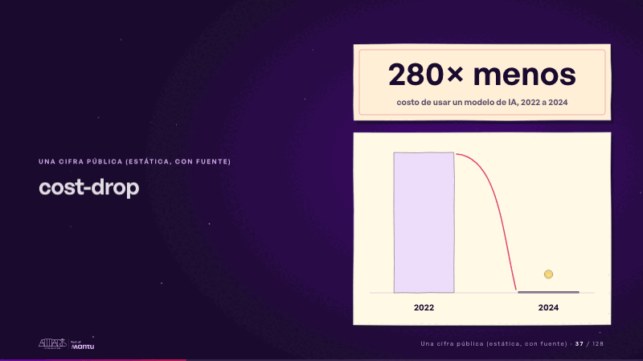
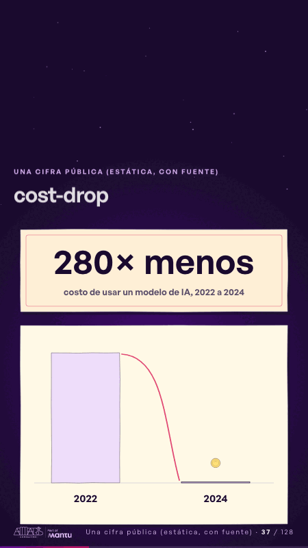

# cost-drop · Una cifra pública (estática, con fuente)

 

## Qué cuenta

Dos barras de papel, 2022 alta y 2024 apenas una línea, y la cifra «280× menos» fija en su marco de papel.

## Cómo respira

La cifra y las barras no se mueven; solo respiran los acentos: una moneda de papel se encoge mientras vuela de la barra alta a la línea de 2024 y queda flotando, la cinta subraya la diferencia y un pulso suave marca la barra pequeña. Cuadro final: el gráfico quieto, la moneda pequeña sobre 2024.

## Cuándo usarla

Intención: **Una cifra pública (estática, con fuente)** (figure). Verticales: cualquiera. Layout `left`; mundo papel. Origen: dcd · escena de catálogo (fidelización). El snippet completo, listo para pegar en un storyboard: [`snippets/cost-drop.json`](../../snippets/cost-drop.json).

## Args

```json
{
 "layout": "left",
 "scene": "cost-drop",
 "args": {
  "figure": "‹como: 280× menos›",
  "label": "‹como: costo de usar un modelo de IA, 2022 a 2024›",
  "years": [
   "‹como: 2022›",
   "‹como: 2024›"
  ]
 }
}
```

## What it is

A public figure, static and sourced scene, layout «left», for any decks. It lands at a glance, then breathes in a slow loop; its args (figure, label, years) carry every visible word, so the same scene serves a new client once the texts are rewritten.

## Relacionadas · Related

- [evidence · La prueba y la evidencia](evidence.md)
- [figure-context · Una cifra pública (estática, con fuente)](figure-context.md)
- [figure-door · Una cifra pública (estática, con fuente)](figure-door.md)
- [figure-growth · Una cifra pública (estática, con fuente)](figure-growth.md)
- [figure-rank · Una cifra pública (estática, con fuente)](figure-rank.md)
- [luz-figures · Una cifra pública (estática, con fuente)](luz-figures.md)

Fuente · source: [`scenes/story/fidelizacion_s01_15.py`](../../scenes/story/fidelizacion_s01_15.py) · sha256 `c89653556c57`
