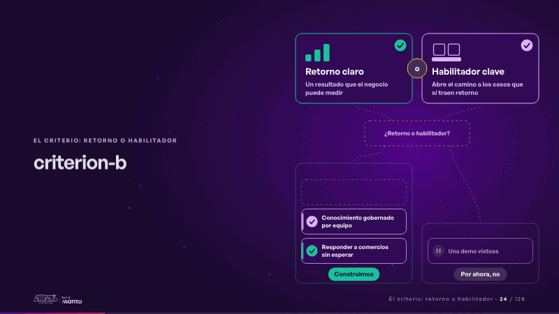
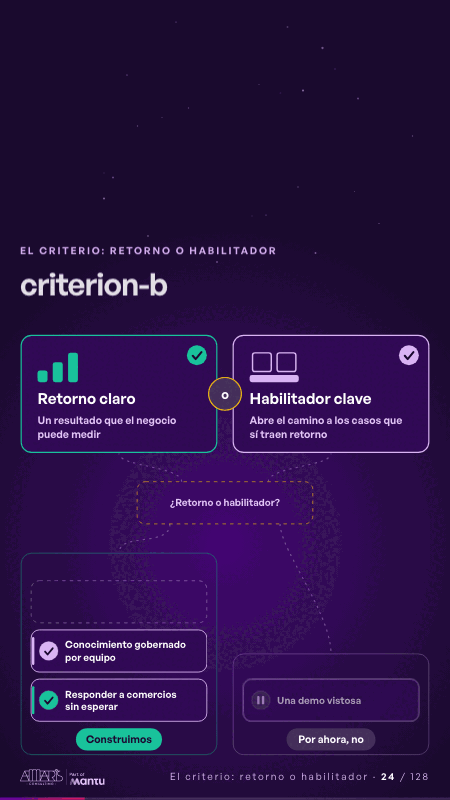

# criterion-b · El criterio: retorno o habilitador

 

## Qué cuenta

Arriba, retorno claro y habilitador clave unidos por una «o»; debajo, un lugar vacío que pregunta «¿Retorno o habilitador?» y dos destinos: «Construimos» y «Por ahora, no».

## Cómo respira

Llegan tres ideas: «Responder a comercios sin esperar» enciende el retorno y se construye; «Una demo vistosa» no enciende ninguno y se aparta, sin drama, a «Por ahora, no»; «Conocimiento gobernado por equipo» enciende el habilitador y también se construye.

## Cuándo usarla

Intención: **El criterio: retorno o habilitador** (criterion). Verticales: cualquiera. Layout `left`. Origen: dcd · escena de catálogo (pagos). El snippet completo, listo para pegar en un storyboard: [`snippets/criterion-b.json`](../../snippets/criterion-b.json).

## Args

```json
{
 "layout": "left",
 "scene": "criterion-b",
 "args": {
  "criteria": [
   [
    "‹como: Retorno claro›",
    "‹como: Un resultado que el negocio puede medir›"
   ],
   [
    "‹como: Habilitador clave›",
    "‹como: Abre el camino a los casos que sí traen retorno›"
   ]
  ],
  "or": "‹como: o›",
  "ask": "‹como: ¿Retorno o habilitador?›",
  "ideas": [
   [
    [
     "‹como: Responder a comercios›",
     "‹como: sin esperar›"
    ],
    "‹como: retorno›"
   ],
   [
    "‹como: Una demo vistosa›",
    "‹como: no›"
   ],
   [
    [
     "‹como: Conocimiento gobernado›",
     "‹como: por equipo›"
    ],
    "‹como: habilitador›"
   ]
  ],
  "build": "‹como: Construimos›",
  "aside": "‹como: Por ahora, no›"
 }
}
```

## What it is

The criterion: return or enabler scene, layout «left», for any decks. It lands at a glance, then breathes in a slow loop; its args (aside, ask, build, criteria, ideas, or) carry every visible word, so the same scene serves a new client once the texts are rewritten.

## Relacionadas · Related

- [adr-decisions · Diseño técnico por capas](adr-decisions.md)
- [criterion · El criterio: retorno o habilitador](criterion.md)
- [funnel-gates · Embudo](funnel-gates.md)
- [luz-escala · El criterio: retorno o habilitador](luz-escala.md)
- [matrix-quadrants · Matriz](matrix-quadrants.md)
- [matrix-table · Matriz](matrix-table.md)

Fuente · source: [`scenes/story/pagos_s10_12.py`](../../scenes/story/pagos_s10_12.py) · sha256 `7f6085991e6e`
