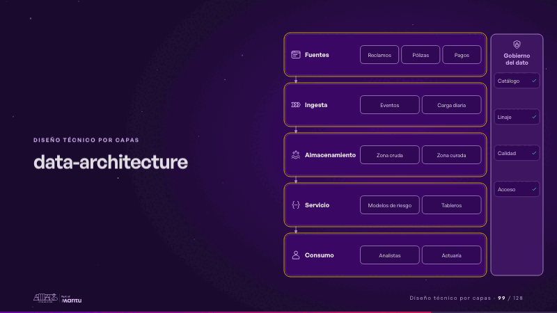
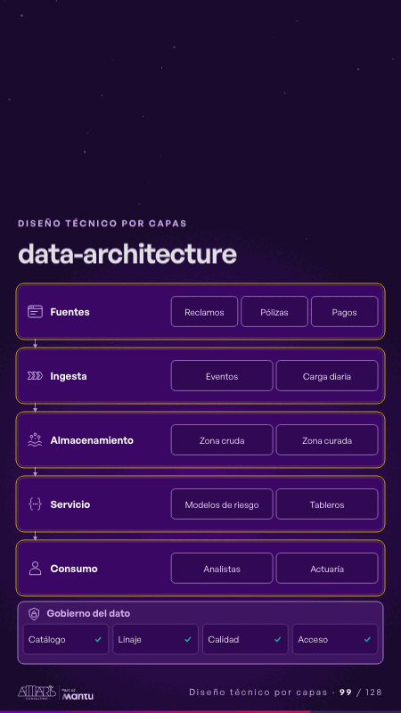

# data-architecture · Diseño técnico por capas

 

## Qué cuenta

Cinco filas del dato, de las fuentes al consumo, y a la derecha el pilar de gobierno con catálogo, linaje, calidad y acceso.

## Cómo respira

Tres datos bajan de las fuentes al consumo encendiendo cada paso; en el pilar de gobierno, cada práctica recibe su visto bueno.

## Cuándo usarla

Intención: **Diseño técnico por capas** (architecture, data, governance). Verticales: cualquiera. Layout `left`. Origen: Arquitectura demo (Aseguradora Andina, ficticia) · diapositiva «El dato del reclamo, del evento al tablero, con gobierno». El snippet completo, listo para pegar en un storyboard: [`snippets/data-architecture.json`](../../snippets/data-architecture.json).

## Args

```json
{
 "layout": "left",
 "scene": "data-architecture",
 "args": {
  "flow": [
   [
    "‹como: Fuentes›",
    [
     "‹como: Reclamos›",
     "‹como: Pólizas›",
     "‹como: Pagos›"
    ]
   ],
   [
    "‹como: Ingesta›",
    [
     "‹como: Eventos›",
     "‹como: Carga diaria›"
    ]
   ],
   [
    "‹como: Almacenamiento›",
    [
     "‹como: Zona cruda›",
     "‹como: Zona curada›"
    ]
   ],
   [
    "‹como: Servicio›",
    [
     "‹como: Modelos de riesgo›",
     "‹como: Tableros›"
    ]
   ],
   [
    "‹como: Consumo›",
    [
     "‹como: Analistas›",
     "‹como: Actuaría›"
    ]
   ]
  ],
  "governance": [
   "‹como: Gobierno del dato›",
   [
    "‹como: Catálogo›",
    "‹como: Linaje›",
    "‹como: Calidad›",
    "‹como: Acceso›"
   ]
  ]
 }
}
```

## What it is

Layered technical design scene, layout «left», for any decks. It lands at a glance, then breathes in a slow loop; its args (flow, governance) carry every visible word, so the same scene serves a new client once the texts are rewritten.

## Relacionadas · Related

- [data-lifecycle · Lo que sus equipos comparten: el dato](data-lifecycle.md)
- [facts-columns · Lo que sus equipos comparten: el dato](facts-columns.md)
- [federated-live · Gobierno, permisos y control](federated-live.md)
- [infra-topology · Diseño técnico por capas](infra-topology.md)
- [knowledge-spaces · Gobierno, permisos y control](knowledge-spaces.md)
- [adr-decisions · Diseño técnico por capas](adr-decisions.md)

Fuente · source: [`scenes/story/arquitectura.py`](../../scenes/story/arquitectura.py) · sha256 `01c6a4b3e10f`
