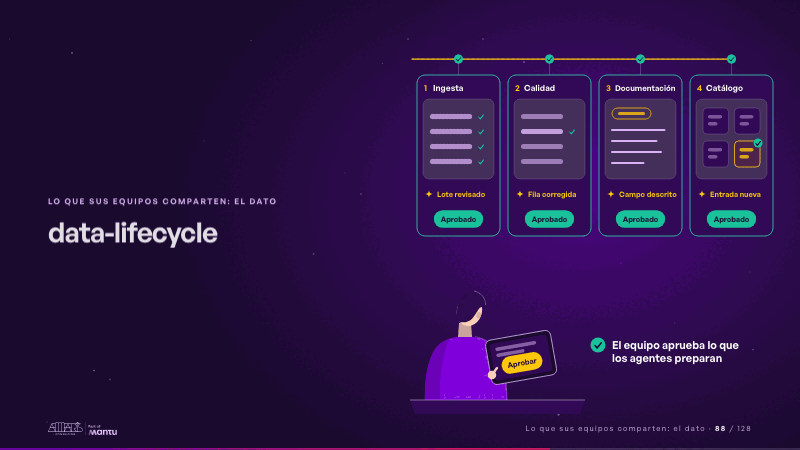
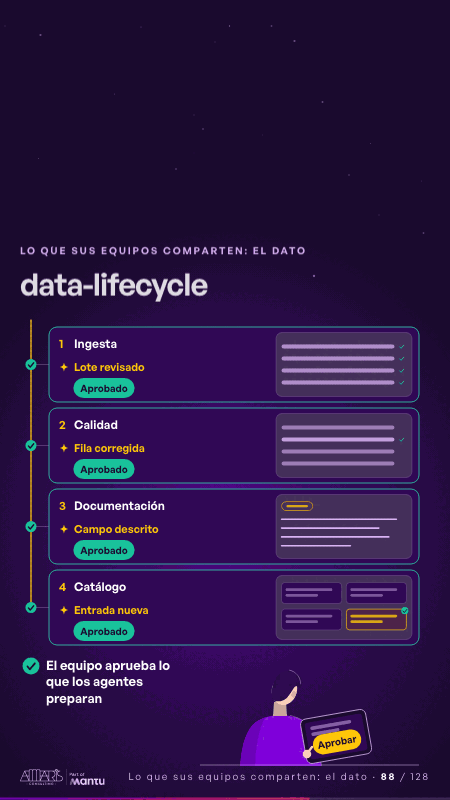

# data-lifecycle · Lo que sus equipos comparten: el dato

 

## Qué cuenta

Un ciclo de vida del dato en cuatro etapas (Ingesta, Calidad, Documentación, Catálogo) bajo la línea por la que viaja el dato; abajo, de espaldas, una persona del equipo de datos con su tablet, y la frase «El equipo aprueba lo que los agentes preparan».

## Cómo respira

Un bucle de 12 segundos: el dato entra y en cada etapa un agente trabaja (llegan las filas y se revisan, una fila rota se corrige, un campo se describe, aparece una entrada en el catálogo); la persona toca «Aprobar», el pulso sube y la etapa queda «Aprobado»; el dato sigue. Cuadro final: las cuatro etapas hechas y aprobadas.

## Cuándo usarla

Intención: **Lo que sus equipos comparten: el dato** (data, governance). Verticales: cualquiera. Layout `left`. Origen: dcd · escena de catálogo (banca). El snippet completo, listo para pegar en un storyboard: [`snippets/data-lifecycle.json`](../../snippets/data-lifecycle.json).

## Args

```json
{
 "layout": "left",
 "scene": "data-lifecycle",
 "args": {
  "phases": [
   "‹como: Ingesta›",
   "‹como: Calidad›",
   "‹como: Documentación›",
   "‹como: Catálogo›"
  ],
  "results": [
   "‹como: Lote revisado›",
   "‹como: Fila corregida›",
   "‹como: Campo descrito›",
   "‹como: Entrada nueva›"
  ],
  "wait": "‹como: En cola›",
  "approve": [
   "‹como: Por aprobar›",
   "‹como: Aprobado›"
  ],
  "tap": "‹como: Aprobar›",
  "label": "‹como: El equipo aprueba lo que los agentes preparan›"
 }
}
```

## What it is

Shared data scene, layout «left», for any decks. It lands at a glance, then breathes in a slow loop; its args (approve, label, phases, results, tap, wait) carry every visible word, so the same scene serves a new client once the texts are rewritten.

## Relacionadas · Related

- [data-architecture · Diseño técnico por capas](data-architecture.md)
- [facts-columns · Lo que sus equipos comparten: el dato](facts-columns.md)
- [knowledge-spaces · Gobierno, permisos y control](knowledge-spaces.md)
- [federated-live · Gobierno, permisos y control](federated-live.md)
- [funnel-stages · Embudo](funnel-stages.md)
- [infra-topology · Diseño técnico por capas](infra-topology.md)

Fuente · source: [`scenes/story/banca_d01_06.py`](../../scenes/story/banca_d01_06.py) · sha256 `9deb39acebfb`
