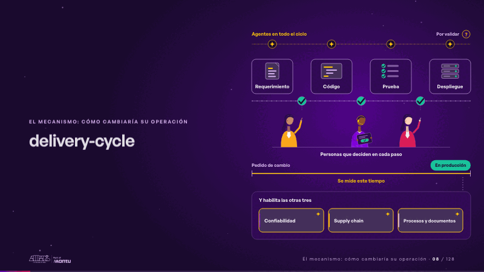
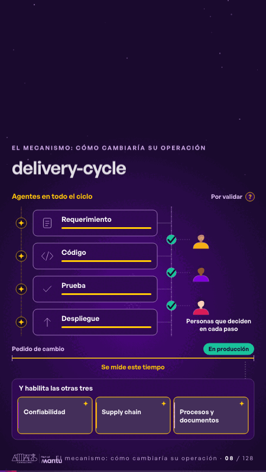

# delivery-cycle · El mecanismo: cómo cambiaría su operación

 

## Qué cuenta

El ciclo se arma: los agentes arriba, los cuatro pasos, las personas en cada punto de decisión y la regla del pedido a producción.

## Cómo respira

Un cambio recorre el ciclo: el agente trabaja en cada paso, una persona decide y sigue, la regla se llena hasta producción y se encienden las otras tres.

## Cuándo usarla

Intención: **El mecanismo: cómo cambiaría su operación** (process, proof). Verticales: cualquiera. Layout `left`. Origen: dcd · escena de catálogo (energía). El snippet completo, listo para pegar en un storyboard: [`snippets/delivery-cycle.json`](../../snippets/delivery-cycle.json).

## Args

```json
{
 "layout": "left",
 "scene": "delivery-cycle",
 "args": {
  "agents": "‹como: Agentes en todo el ciclo›",
  "tag": "‹como: Por validar›",
  "steps": [
   "‹como: Requerimiento›",
   "‹como: Código›",
   "‹como: Prueba›",
   "‹como: Despliegue›"
  ],
  "people": "‹como: Personas que deciden en cada paso›",
  "start": "‹como: Pedido de cambio›",
  "end": "‹como: En producción›",
  "measure": "‹como: Se mide este tiempo›",
  "enables": "‹como: Y habilita las otras tres›",
  "areas": [
   "‹como: Confiabilidad›",
   "‹como: Supply chain›",
   "‹como: Procesos y documentos›"
  ]
 }
}
```

## What it is

The mechanism scene, layout «left», for any decks. It lands at a glance, then breathes in a slow loop; its args (agents, areas, enables, end, measure, people, start, steps, tag) carry every visible word, so the same scene serves a new client once the texts are rewritten.

## Relacionadas · Related

- [repeat-story · La brecha: su idea y lo que pasa cuando no se cumple](repeat-story.md)
- [discovery · Próximo paso: formas de empezar y discovery](discovery.md)
- [criterion · El criterio: retorno o habilitador](criterion.md)
- [hypotheses-live · Hipótesis por validar](hypotheses-live.md)
- [tickets-live · Cierre: su futuro, funcionando (el lema)](tickets-live.md)
- [hypotheses-quarter · Portada: su promesa](hypotheses-quarter.md)

Fuente · source: [`scenes/story/energia_s07_09.py`](../../scenes/story/energia_s07_09.py) · sha256 `502b3916baba`
