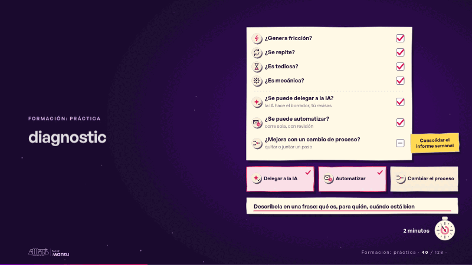
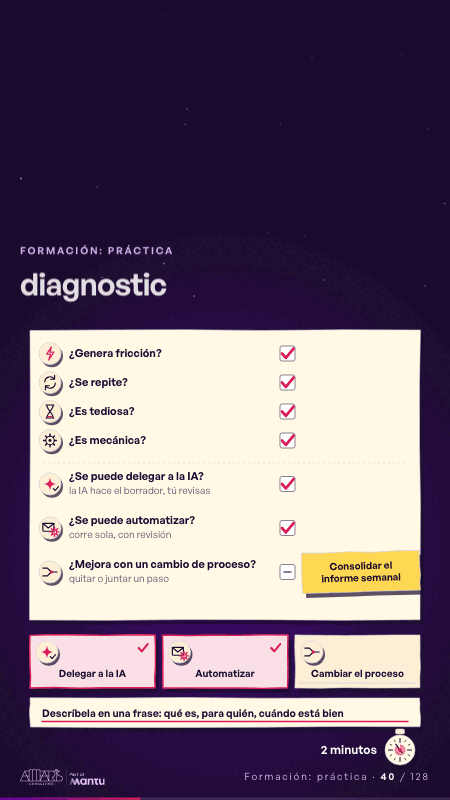

# diagnostic · Formación: práctica

 

## Qué cuenta

Una hoja de diagnóstico de papel con siete preguntas, cada una con su ícono y su casilla, todas a la vista; debajo, tres bandejas (delegar a la IA, automatizar, cambiar el proceso), la ficha «Consolidar el informe semanal» junto a la primera pregunta y un reloj de papel de dos minutos.

## Cómo respira

La ficha baja pregunta por pregunta y marca las que aplican, y las marcas se acumulan: las seis primeras reciben su visto y la séptima queda en «no»; se encienden las bandejas «Delegar a la IA» y «Automatizar» y aparece la línea final, «Descríbela en una frase: qué es, para quién, cuándo está bien». El reloj de dos minutos da su vuelta. Cuadro final: las siete preguntas con sus marcas, dos bandejas encendidas y la línea final.

## Cuándo usarla

Intención: **Formación: práctica** (hands-on). Verticales: cualquiera. Layout `left`; mundo papel. Origen: dcd · escena de catálogo (fidelización). El snippet completo, listo para pegar en un storyboard: [`snippets/diagnostic.json`](../../snippets/diagnostic.json).

## Args

```json
{
 "layout": "left",
 "scene": "diagnostic",
 "args": {
  "task": "‹como: Consolidar el informe semanal›",
  "lenses": [
   {
    "q": "‹como: ¿Genera fricción?›",
    "icon": "‹como: friccion›",
    "tick": true
   },
   {
    "q": "‹como: ¿Se repite?›",
    "icon": "‹como: repite›",
    "tick": true
   },
   {
    "q": "‹como: ¿Es tediosa?›",
    "icon": "‹como: tediosa›",
    "tick": true
   },
   {
    "q": "‹como: ¿Es mecánica?›",
    "icon": "‹como: mecanica›",
    "tick": true
   },
   {
    "q": "‹como: ¿Se puede delegar a la IA?›",
    "hint": "‹como: la IA hace el borrador, tú revisas›",
    "icon": "‹como: ia›",
    "tick": true
   },
   {
    "q": "‹como: ¿Se puede automatizar?›",
    "hint": "‹como: corre sola, con revisión›",
    "icon": "‹como: auto›",
    "tick": true
   },
   {
    "q": "‹como: ¿Mejora con un cambio de proceso?›",
    "hint": "‹como: quitar o juntar un paso›",
    "icon": "‹como: proceso›",
    "tick": false
   }
  ],
  "trays": [
   "‹como: Delegar a la IA›",
   "‹como: Automatizar›",
   "‹como: Cambiar el proceso›"
  ],
  "close": "‹como: Descríbela en una frase: qué es, para quién, cuándo está bien›",
  "clock": "‹como: 2 minutos›"
 }
}
```

## What it is

Training: hands-on scene, layout «left», for any decks. It lands at a glance, then breathes in a slow loop; its args (clock, close, lenses, task, trays) carry every visible word, so the same scene serves a new client once the texts are rewritten.

## Relacionadas · Related

- [hands-on-timer · Formación: práctica](hands-on-timer.md)
- [pair-read · Formación: práctica](pair-read.md)

Fuente · source: [`scenes/story/fidelizacion_s01_15.py`](../../scenes/story/fidelizacion_s01_15.py) · sha256 `c89653556c57`
