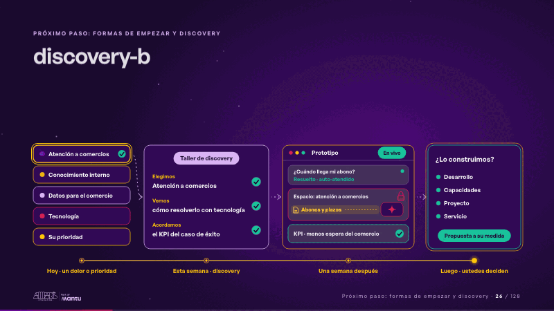
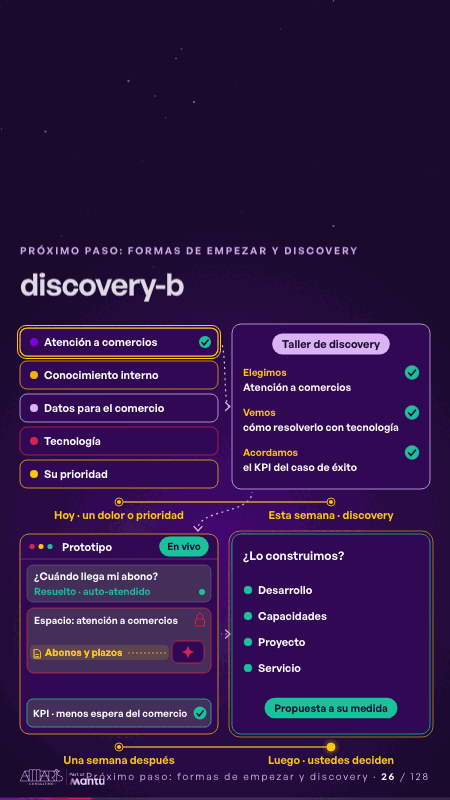

# discovery-b · Próximo paso: formas de empezar y discovery

 

## Qué cuenta

Sus opciones a la izquierda y, sobre una línea de tiempo, el taller de discovery, el prototipo y su decisión.

## Cómo respira

En 12 segundos: se elige atención a comercios, el taller define cómo resolverlo y su KPI, el prototipo cobra vida (una consulta de un comercio, el agente responde desde su espacio y su fuente, el ticket se cierra solo) y llega la propuesta para que decidan.

## Cuándo usarla

Intención: **Próximo paso: formas de empezar y discovery** (cta, process). Verticales: cualquiera. Layout `top`. Origen: dcd · escena de catálogo (pagos). El snippet completo, listo para pegar en un storyboard: [`snippets/discovery-b.json`](../../snippets/discovery-b.json).

## Args

```json
{
 "layout": "top",
 "scene": "discovery-b",
 "args": {
  "cards": [
   "‹como: Atención a comercios›",
   "‹como: Conocimiento interno›",
   "‹como: Datos para el comercio›",
   "‹como: Tecnología›",
   "‹como: Su prioridad›"
  ],
  "workshop": [
   "‹como: Taller de discovery›",
   [
    [
     "‹como: Elegimos›",
     "‹como: un dolor o una prioridad›"
    ],
    [
     "‹como: Vemos›",
     "‹como: cómo resolverlo con tecnología›"
    ],
    [
     "‹como: Acordamos›",
     "‹como: el KPI del caso de éxito›"
    ]
   ]
  ],
  "proto": "‹como: Prototipo›",
  "offer": [
   "‹como: ¿Lo construimos?›",
   [
    "‹como: Desarrollo›",
    "‹como: Capacidades›",
    "‹como: Proyecto›",
    "‹como: Servicio›"
   ]
  ],
  "decide": "‹como: Propuesta a su medida›",
  "when": [
   "‹como: Hoy · un dolor o prioridad›",
   "‹como: Esta semana · discovery›",
   "‹como: Una semana después›",
   "‹como: Luego · ustedes deciden›"
  ],
  "pick": 0,
  "live": "‹como: En vivo›",
  "ticket": "‹como: ¿Cuándo llega mi abono?›",
  "new": "‹como: Nuevo›",
  "solved": "‹como: Resuelto · auto-atendido›",
  "space": "‹como: Espacio: atención a comercios›",
  "doc": "‹como: Abonos y plazos›",
  "kpi": "‹como: KPI · menos espera del comercio›"
 }
}
```

## What it is

Next step scene, layout «top», for any decks. It lands at a glance, then breathes in a slow loop; its args (cards, decide, doc, kpi, live, new, offer, pick, proto, solved, space, ticket, when, workshop) carry every visible word, so the same scene serves a new client once the texts are rewritten.

## Relacionadas · Related

- [discovery · Próximo paso: formas de empezar y discovery](discovery.md)
- [roadmap-phases · Hoja de ruta](roadmap-phases.md)
- [arq-roadmap · Próximo paso: formas de empezar y discovery](arq-roadmap.md)
- [automation-stairs · El mecanismo: cómo cambiaría su operación](automation-stairs.md)
- [before-after-lanes · Antes y después](before-after-lanes.md)
- [before-after-split · Antes y después](before-after-split.md)

Fuente · source: [`scenes/story/pagos_s13_15.py`](../../scenes/story/pagos_s13_15.py) · sha256 `de77ed17064f`
