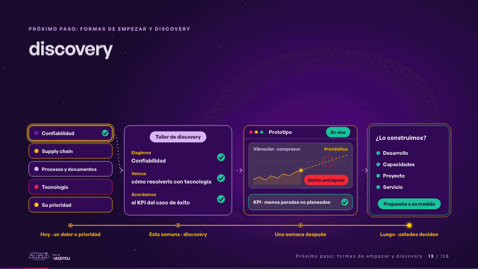
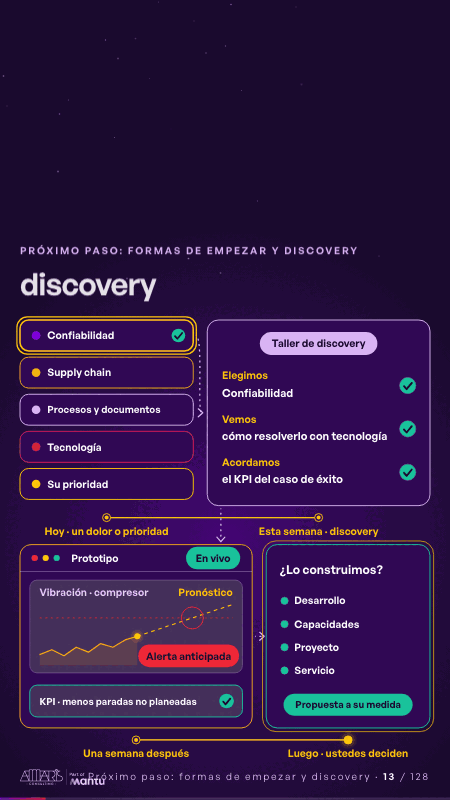

# discovery · Próximo paso: formas de empezar y discovery

 

## Qué cuenta

Sus opciones a la izquierda y, sobre una línea de tiempo, el taller de discovery, el prototipo y su decisión.

## Cómo respira

En 12 segundos: se elige un dolor, el taller define cómo resolverlo y el KPI, el prototipo cobra vida con su alerta y llega la propuesta para que decidan.

## Cuándo usarla

Intención: **Próximo paso: formas de empezar y discovery** (cta, process). Verticales: cualquiera. Layout `top`. Origen: dcd · escena de catálogo (energía). El snippet completo, listo para pegar en un storyboard: [`snippets/discovery.json`](../../snippets/discovery.json).

## Args

```json
{
 "layout": "top",
 "scene": "discovery",
 "args": {
  "cards": [
   "‹como: Confiabilidad›",
   "‹como: Supply chain›",
   "‹como: Procesos y documentos›",
   "‹como: Tecnología›",
   "‹como: Su prioridad›"
  ],
  "pick": 0,
  "workshop": [
   "‹como: Taller de discovery›",
   [
    [
     "‹como: Elegimos›",
     "‹como: un dolor o una prioridad›"
    ],
    [
     "‹como: Vemos›",
     "‹como: cómo resolverlo con tecnología›"
    ],
    [
     "‹como: Acordamos›",
     "‹como: el KPI del caso de éxito›"
    ]
   ]
  ],
  "proto": "‹como: Prototipo›",
  "live": "‹como: En vivo›",
  "chart": "‹como: Vibración · compresor›",
  "forecast": "‹como: Pronóstico›",
  "alert": "‹como: Alerta anticipada›",
  "kpi": "‹como: KPI · menos paradas no planeadas›",
  "offer": [
   "‹como: ¿Lo construimos?›",
   [
    "‹como: Desarrollo›",
    "‹como: Capacidades›",
    "‹como: Proyecto›",
    "‹como: Servicio›"
   ]
  ],
  "decide": "‹como: Propuesta a su medida›",
  "when": [
   "‹como: Hoy · un dolor o prioridad›",
   "‹como: Esta semana · discovery›",
   "‹como: Una semana después›",
   "‹como: Luego · ustedes deciden›"
  ]
 }
}
```

## What it is

Next step scene, layout «top», for any decks. It lands at a glance, then breathes in a slow loop; its args (alert, cards, chart, decide, forecast, kpi, live, offer, pick, proto, when, workshop) carry every visible word, so the same scene serves a new client once the texts are rewritten.

## Relacionadas · Related

- [hypotheses-live · Hipótesis por validar](hypotheses-live.md)
- [criterion · El criterio: retorno o habilitador](criterion.md)
- [repeat-story · La brecha: su idea y lo que pasa cuando no se cumple](repeat-story.md)
- [tickets-live · Cierre: su futuro, funcionando (el lema)](tickets-live.md)
- [hypotheses-quarter · Portada: su promesa](hypotheses-quarter.md)
- [outside-business · Desde afuera: lo que vimos en fuentes públicas](outside-business.md)

Fuente · source: [`scenes/story/energia_s13_15.py`](../../scenes/story/energia_s13_15.py) · sha256 `ee2c99a06c9a`
