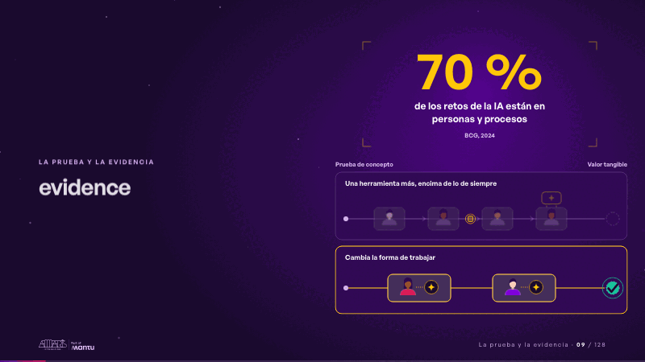
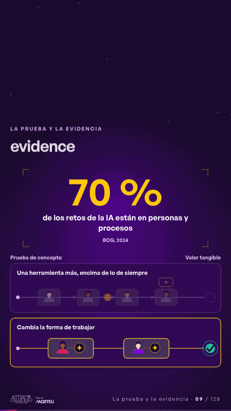

# evidence · La prueba y la evidencia

 

## Qué cuenta

La cifra queda quieta con su etiqueta y su fuente; debajo, dos caminos de la prueba de concepto al valor.

## Cómo respira

Primero, una herramienta más sobre lo de siempre: el trabajo espera donde siempre esperó. Después cambia la forma de trabajar: personas con IA dentro del flujo, y el trabajo llega al valor.

## Cuándo usarla

Intención: **La prueba y la evidencia** (proof, figure). Verticales: cualquiera. Layout `left`. Origen: dcd · escena de catálogo (energía). El snippet completo, listo para pegar en un storyboard: [`snippets/evidence.json`](../../snippets/evidence.json).

## Args

```json
{
 "layout": "left",
 "scene": "evidence",
 "args": {
  "figure": "‹como: 70 %›",
  "label": "‹como: de los retos de la IA están en personas y procesos›",
  "source": "‹como: BCG, 2024›",
  "start": "‹como: Prueba de concepto›",
  "end": "‹como: Valor tangible›",
  "old": "‹como: Una herramienta más, encima de lo de siempre›",
  "new": "‹como: Cambia la forma de trabajar›"
 }
}
```

## What it is

Proof and evidence scene, layout «left», for any decks. It lands at a glance, then breathes in a slow loop; its args (end, figure, label, new, old, source, start) carry every visible word, so the same scene serves a new client once the texts are rewritten.

## Relacionadas · Related

- [criterion · El criterio: retorno o habilitador](criterion.md)
- [discovery · Próximo paso: formas de empezar y discovery](discovery.md)
- [outside-business · Desde afuera: lo que vimos en fuentes públicas](outside-business.md)
- [repeat-story · La brecha: su idea y lo que pasa cuando no se cumple](repeat-story.md)
- [hypotheses-live · Hipótesis por validar](hypotheses-live.md)
- [tickets-live · Cierre: su futuro, funcionando (el lema)](tickets-live.md)

Fuente · source: [`scenes/story/energia_s07_09.py`](../../scenes/story/energia_s07_09.py) · sha256 `502b3916baba`
