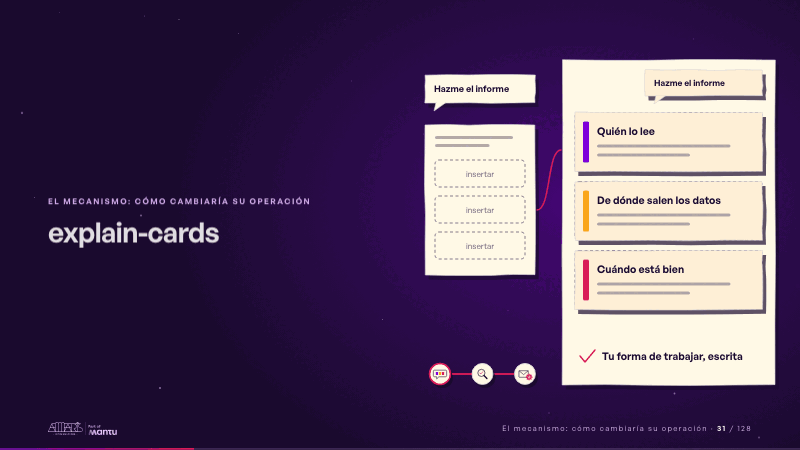
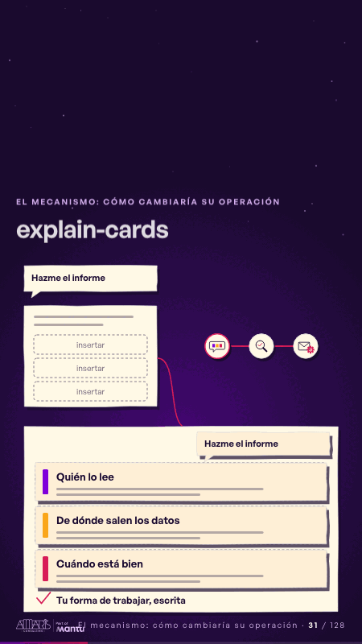

# explain-cards · El mecanismo: cómo cambiaría su operación

 

## Qué cuenta

A la izquierda, pequeño, el pedido «Hazme el informe» y su plantilla hueca con tres huecos «insertar»; a la derecha, una hoja de chat de papel con el mismo pedido y tres huecos vacíos; abajo, el mapa pequeño de tres paradas.

## Cómo respira

Entran tres fichas, una por una (quién lo lee, de dónde salen los datos, cuándo está bien), y cada una llena su hueco; la hoja se firma «tu forma de trabajar, escrita» y en la esquina se enciende la primera parada del mapa. Cuadro final: las tres fichas en la hoja completa y la primera parada encendida.

## Cuándo usarla

Intención: **El mecanismo: cómo cambiaría su operación** (process). Verticales: cualquiera. Layout `left`; mundo papel. Origen: dcd · escena de catálogo (fidelización). El snippet completo, listo para pegar en un storyboard: [`snippets/explain-cards.json`](../../snippets/explain-cards.json).

## Args

```json
{
 "layout": "left",
 "scene": "explain-cards",
 "args": {
  "ask": "‹como: Hazme el informe›",
  "insert": "‹como: insertar›",
  "cards": [
   "‹como: Quién lo lee›",
   "‹como: De dónde salen los datos›",
   "‹como: Cuándo está bien›"
  ],
  "done": "‹como: Tu forma de trabajar, escrita›"
 }
}
```

## What it is

The mechanism scene, layout «left», for any decks. It lands at a glance, then breathes in a slow loop; its args (ask, cards, done, insert) carry every visible word, so the same scene serves a new client once the texts are rewritten.

## Relacionadas · Related

- [automation-stairs · El mecanismo: cómo cambiaría su operación](automation-stairs.md)
- [before-after-lanes · Antes y después](before-after-lanes.md)
- [before-after-split · Antes y después](before-after-split.md)
- [build-deliver · Formación: la demo en vivo](build-deliver.md)
- [delivery-cycle · El mecanismo: cómo cambiaría su operación](delivery-cycle.md)
- [discovery · Próximo paso: formas de empezar y discovery](discovery.md)

Fuente · source: [`scenes/story/fidelizacion_s01_15.py`](../../scenes/story/fidelizacion_s01_15.py) · sha256 `c89653556c57`
