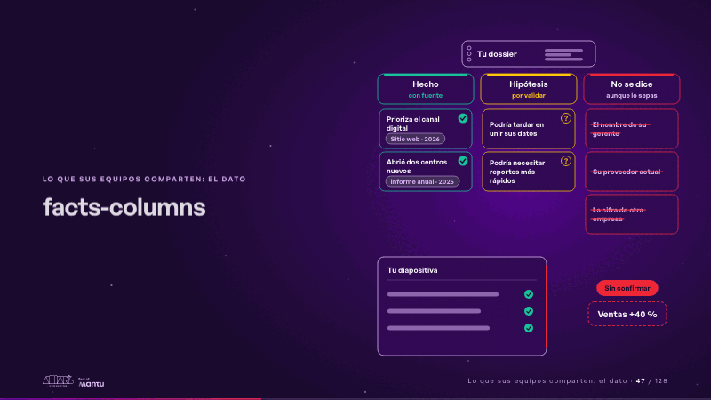
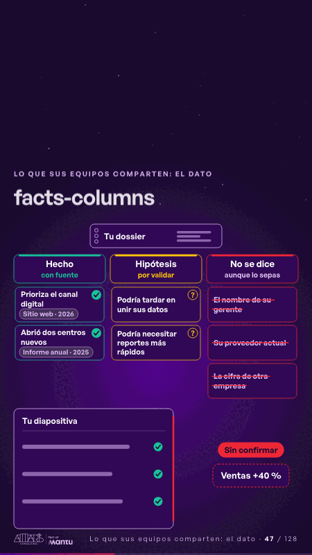

# facts-columns · Lo que sus equipos comparten: el dato

 

## Qué cuenta

Tu dossier arriba, tres columnas debajo (Hecho con fuente, Hipótesis por validar, No se dice) con sus huecos, y tu diapositiva abajo; la primera frase ya cae en su columna.

## Cómo respira

Las frases del dossier caen una a una en su columna: los hechos reciben su visto y su fuente con fecha, las hipótesis su «?», y lo que no se dice (el nombre del gerente, el proveedor actual, la cifra de otra empresa) queda tachado. Luego una cifra sin fuente intenta entrar en tu diapositiva, choca con su borde y queda afuera: «Sin confirmar».

## Cuándo usarla

Intención: **Lo que sus equipos comparten: el dato** (data, governance). Verticales: formacion. Layout `left`. Origen: Clase VR (formación) · diapositiva «Separas lo que sabes de lo que supones». El snippet completo, listo para pegar en un storyboard: [`snippets/facts-columns.json`](../../snippets/facts-columns.json).

## Args

```json
{
 "layout": "left",
 "scene": "facts-columns",
 "args": {
  "dossier": "‹como: Tu dossier›",
  "columns": [
   {
    "head": "‹como: Hecho›",
    "tag": "‹como: con fuente›"
   },
   {
    "head": "‹como: Hipótesis›",
    "tag": "‹como: por validar›"
   },
   {
    "head": "‹como: No se dice›",
    "tag": "‹como: aunque lo sepas›"
   }
  ],
  "facts": [
   {
    "text": "‹como: Prioriza el canal digital›",
    "src": "‹como: Sitio web · 2026›"
   },
   {
    "text": "‹como: Abrió dos centros nuevos›",
    "src": "‹como: Informe anual · 2025›"
   }
  ],
  "hyps": [
   "‹como: Podría tardar en unir sus datos›",
   "‹como: Podría necesitar reportes más rápidos›"
  ],
  "nots": [
   "‹como: El nombre de su gerente›",
   "‹como: Su proveedor actual›",
   "‹como: La cifra de otra empresa›"
  ],
  "slide_label": "‹como: Tu diapositiva›",
  "stop": "‹como: Sin confirmar›",
  "unsourced": "‹como: Ventas +40 %›"
 }
}
```

## What it is

Shared data scene, layout «left», for formacion decks. It lands at a glance, then breathes in a slow loop; its args (columns, dossier, facts, hyps, nots, slide_label, stop, unsourced) carry every visible word, so the same scene serves a new client once the texts are rewritten.

## Relacionadas · Related

- [week-calendar · La brecha: su idea y lo que pasa cuando no se cumple](week-calendar.md)
- [hypotheses-live · Hipótesis por validar](hypotheses-live.md)
- [knowledge-spaces · Gobierno, permisos y control](knowledge-spaces.md)
- [data-architecture · Diseño técnico por capas](data-architecture.md)
- [data-lifecycle · Lo que sus equipos comparten: el dato](data-lifecycle.md)
- [lema-conversation · Cierre: su futuro, funcionando (el lema)](lema-conversation.md)

Fuente · source: [`scenes/story/formacion_s04_06.py`](../../scenes/story/formacion_s04_06.py) · sha256 `b5c2493ae72d`
