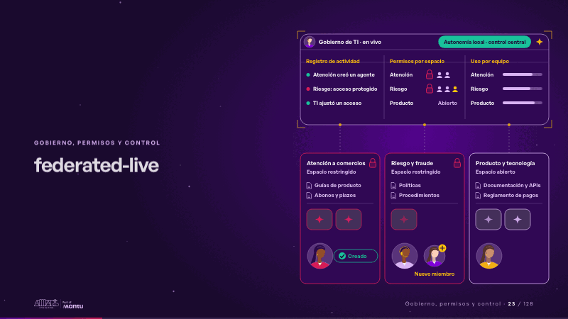
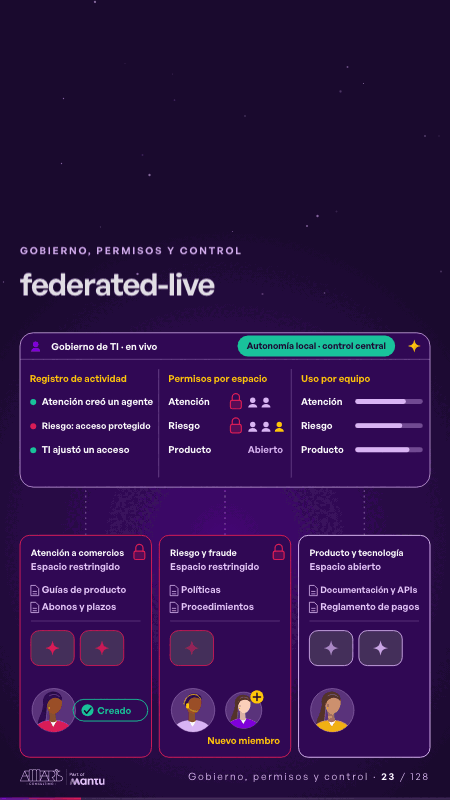

# federated-live · Gobierno, permisos y control

 

## Qué cuenta

Arriba, la consola de TI con el registro de actividad, los permisos por espacio y el uso por equipo; abajo, tres espacios de equipo (atención, riesgo y producto), cada uno con su persona, sus fuentes y sus agentes.

## Cómo respira

Una persona de atención crea su agente y el registro lo anota; el agente responde con las fuentes de su espacio y el candado de riesgo se mantiene; los otros equipos también responden y su uso sube; TI suma un miembro al espacio restringido, el cambio baja al espacio y queda en el registro.

## Cuándo usarla

Intención: **Gobierno, permisos y control** (governance, architecture). Verticales: cualquiera. Layout `left`. Origen: dcd · escena de catálogo (pagos). El snippet completo, listo para pegar en un storyboard: [`snippets/federated-live.json`](../../snippets/federated-live.json).

## Args

```json
{
 "layout": "left",
 "scene": "federated-live",
 "args": {
  "console": "‹como: Gobierno de TI · en vivo›",
  "panes": [
   "‹como: Registro de actividad›",
   "‹como: Permisos por espacio›",
   "‹como: Uso por equipo›"
  ],
  "spaces": [
   [
    "‹como: Atención a comercios›",
    "‹como: Atención›",
    "‹como: Espacio restringido›",
    true,
    [
     "‹como: Guías de producto›",
     "‹como: Abonos y plazos›"
    ],
    1
   ],
   [
    "‹como: Riesgo y fraude›",
    "‹como: Riesgo›",
    "‹como: Espacio restringido›",
    true,
    [
     "‹como: Políticas›",
     "‹como: Procedimientos›"
    ],
    1
   ],
   [
    "‹como: Producto y tecnología›",
    "‹como: Producto›",
    "‹como: Espacio abierto›",
    false,
    [
     "‹como: Documentación y APIs›",
     "‹como: Reglamento de pagos›"
    ],
    2
   ]
  ],
  "open": "‹como: Abierto›",
  "create": "‹como: Crear agente›",
  "created": "‹como: Creado›",
  "member": "‹como: Nuevo miembro›",
  "log": [
   "‹como: Atención creó un agente›",
   "‹como: Riesgo: acceso protegido›",
   "‹como: TI ajustó un acceso›"
  ],
  "status": "‹como: Autonomía local · control central›"
 }
}
```

## What it is

Governance, permissions and control scene, layout «left», for any decks. It lands at a glance, then breathes in a slow loop; its args (console, create, created, log, member, open, panes, spaces, status) carry every visible word, so the same scene serves a new client once the texts are rewritten.

## Relacionadas · Related

- [data-architecture · Diseño técnico por capas](data-architecture.md)
- [infra-topology · Diseño técnico por capas](infra-topology.md)
- [adr-decisions · Diseño técnico por capas](adr-decisions.md)
- [arq-hero · Portada: su promesa](arq-hero.md)
- [automation-stairs · El mecanismo: cómo cambiaría su operación](automation-stairs.md)
- [c4-code · Diseño técnico por capas](c4-code.md)

Fuente · source: [`scenes/story/pagos_s10_12.py`](../../scenes/story/pagos_s10_12.py) · sha256 `7f6085991e6e`
