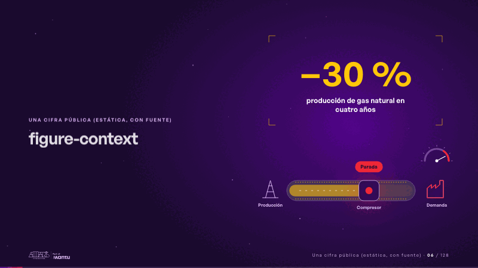
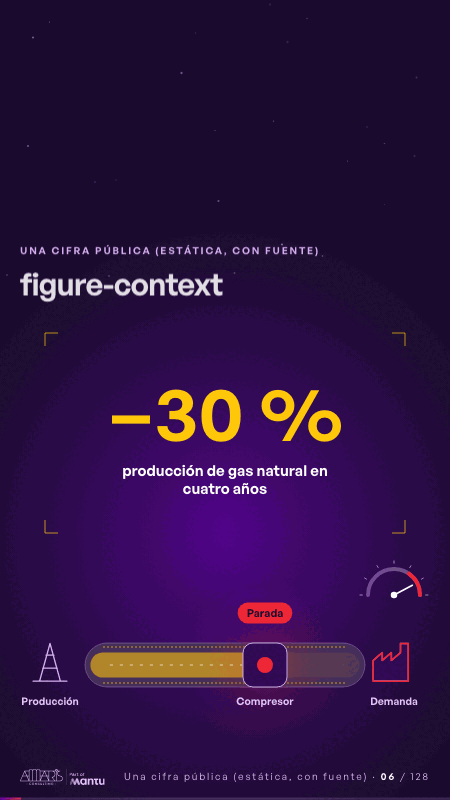

# figure-context · Una cifra pública (estática, con fuente)

 

## Qué cuenta

La cifra aparece quieta en su marco y, debajo, la línea de gas va de la producción a la demanda.

## Cómo respira

La banda de gas se adelgaza, el indicador de la demanda sube y el compresor se detiene; la cifra no se mueve.

## Cuándo usarla

Intención: **Una cifra pública (estática, con fuente)** (figure). Verticales: energia. Layout `left`. Origen: dcd · escena de catálogo (energía). El snippet completo, listo para pegar en un storyboard: [`snippets/figure-context.json`](../../snippets/figure-context.json).

## Args

```json
{
 "layout": "left",
 "scene": "figure-context",
 "args": {
  "figure": "‹como: −30 %›",
  "label": "‹como: producción de gas natural en cuatro años›",
  "supply": "‹como: Producción›",
  "station": "‹como: Compresor›",
  "demand": "‹como: Demanda›",
  "chip": "‹como: Parada›"
 }
}
```

## What it is

A public figure, static and sourced scene, layout «left», for energia decks. It lands at a glance, then breathes in a slow loop; its args (chip, demand, figure, label, station, supply) carry every visible word, so the same scene serves a new client once the texts are rewritten.

## Relacionadas · Related

- [hypotheses-live · Hipótesis por validar](hypotheses-live.md)
- [repeat-story · La brecha: su idea y lo que pasa cuando no se cumple](repeat-story.md)
- [chain-tap · Diseño técnico por capas](chain-tap.md)
- [criterion · El criterio: retorno o habilitador](criterion.md)
- [discovery · Próximo paso: formas de empezar y discovery](discovery.md)
- [hypotheses-quarter · Portada: su promesa](hypotheses-quarter.md)

Fuente · source: [`scenes/story/energia_s04_06.py`](../../scenes/story/energia_s04_06.py) · sha256 `4361cd39f477`
