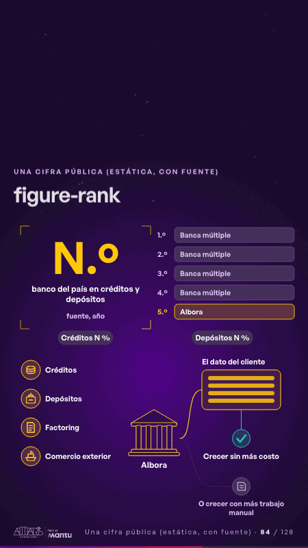

# figure-rank · Una cifra pública (estática, con fuente)

 

## Qué cuenta

La cifra quieta en su marco, junto a un ranking de cinco barras donde la quinta, la del banco, está encendida, con sus dos participaciones; debajo, el banco y dos caminos.

## Cómo respira

Créditos, depósitos, factoring y comercio exterior se encienden por turnos y entran al banco; por un camino se encuentran con el dato del cliente y se enciende crecer sin más costo; el otro, crecer con más trabajo manual, queda dibujado y apagado.

## Cuándo usarla

Intención: **Una cifra pública (estática, con fuente)** (figure). Verticales: banca. Layout `left`. Origen: dcd · escena de catálogo (banca). El snippet completo, listo para pegar en un storyboard: [`snippets/figure-rank.json`](../../snippets/figure-rank.json).

## Args

```json
{
 "layout": "left",
 "scene": "figure-rank",
 "args": {
  "figure": "‹como: N.º›",
  "label": "‹como: banco del país en créditos y depósitos · fuente, año›",
  "ranking": "‹como: Banca múltiple›",
  "door": "‹como: Albora›",
  "shares": [
   "‹como: Créditos N %›",
   "‹como: Depósitos N %›"
  ],
  "services": [
   "‹como: Créditos›",
   "‹como: Depósitos›",
   "‹como: Factoring›",
   "‹como: Comercio exterior›"
  ],
  "record": "‹como: El dato del cliente›",
  "ontime": "‹como: Crecer sin más costo›",
  "late": "‹como: O crecer con más trabajo manual›"
 }
}
```

## What it is

A public figure, static and sourced scene, layout «left», for banca decks. It lands at a glance, then breathes in a slow loop; its args (door, figure, label, late, ontime, ranking, record, services, shares) carry every visible word, so the same scene serves a new client once the texts are rewritten.

## Relacionadas · Related

- [hypotheses-bank · Hipótesis por validar](hypotheses-bank.md)
- [repeat-story · La brecha: su idea y lo que pasa cuando no se cumple](repeat-story.md)
- [cost-drop · Una cifra pública (estática, con fuente)](cost-drop.md)
- [evidence · La prueba y la evidencia](evidence.md)
- [figure-context · Una cifra pública (estática, con fuente)](figure-context.md)
- [figure-door · Una cifra pública (estática, con fuente)](figure-door.md)

Fuente · source: [`scenes/story/banca_s01_14.py`](../../scenes/story/banca_s01_14.py) · sha256 `f268b7f9fd00`
