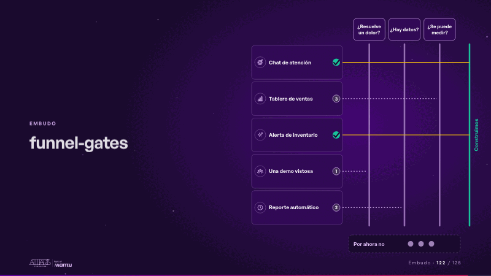
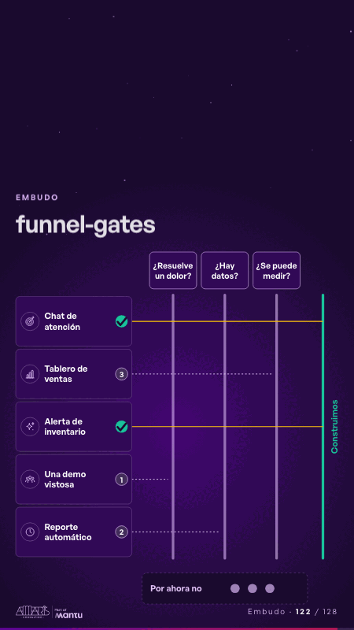

# funnel-gates · Embudo

 

## Qué cuenta

A la izquierda, cinco ideas con los íconos de su sector; al medio, tres preguntas como compuertas; abajo, la bandeja «Por ahora no»; al final, «Construimos».

## Cómo respira

Cada idea corre hacia el final; donde una pregunta dice que no, baja sin drama a «Por ahora no» y su fila queda marcada con el número de esa pregunta; las demás llegan al final con su visto. Queda: cada idea con su destino.

## Cuándo usarla

Intención: **Embudo** (funnel, criterion, hypotheses). Verticales: cualquiera. Layout `left`. Origen: dcd 0.6.0 · escena de catálogo. El snippet completo, listo para pegar en un storyboard: [`snippets/funnel-gates.json`](../../snippets/funnel-gates.json).

## Args

```json
{
 "layout": "left",
 "scene": "funnel-gates",
 "args": {
  "ideas": [
   "‹como: Chat de atención›",
   "‹como: Tablero de ventas›",
   "‹como: Alerta de inventario›",
   "‹como: Una demo vistosa›",
   "‹como: Reporte automático›"
  ],
  "gates": [
   "‹como: ¿Resuelve un dolor?›",
   "‹como: ¿Hay datos?›",
   "‹como: ¿Se puede medir?›"
  ],
  "stops": [
   -1,
   2,
   -1,
   0,
   1
  ],
  "aside": "‹como: Por ahora no›",
  "keep": "‹como: Construimos›"
 }
}
```

## What it is

Funnel scene, layout «left», for any decks. It lands at a glance, then breathes in a slow loop; its args (aside, gates, ideas, keep, stops) carry every visible word, so the same scene serves a new client once the texts are rewritten.

## Relacionadas · Related

- [matrix-quadrants · Matriz](matrix-quadrants.md)
- [adr-decisions · Diseño técnico por capas](adr-decisions.md)
- [criterion · El criterio: retorno o habilitador](criterion.md)
- [criterion-b · El criterio: retorno o habilitador](criterion-b.md)
- [funnel-stages · Embudo](funnel-stages.md)
- [funnel-weeks · Hipótesis por validar](funnel-weeks.md)

Fuente · source: [`scenes/story/intents_s09_16.py`](../../scenes/story/intents_s09_16.py) · sha256 `cf63c5919182`
