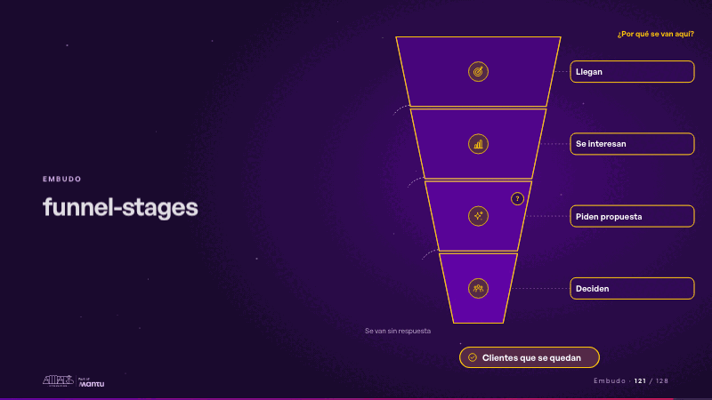
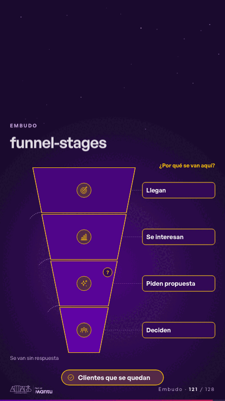

# funnel-stages · Embudo

 

## Qué cuenta

Un embudo de cuatro etapas, cada una con un ícono de su sector y su nombre a la derecha; a la izquierda, las salidas punteadas; abajo, el resultado.

## Cómo respira

El flujo cae por el embudo; en cada etapa una parte sale por el costado y la etapa se enciende; al final la etapa señalada recibe su «?» y se enciende el resultado. Queda: las etapas encendidas y la pregunta en su lugar. Sin cifras: solo el orden.

## Cuándo usarla

Intención: **Embudo** (funnel, gap, data). Verticales: cualquiera. Layout `left`. Origen: dcd 0.6.0 · escena de catálogo. El snippet completo, listo para pegar en un storyboard: [`snippets/funnel-stages.json`](../../snippets/funnel-stages.json).

## Args

```json
{
 "layout": "left",
 "scene": "funnel-stages",
 "args": {
  "levels": [
   "‹como: Llegan›",
   "‹como: Se interesan›",
   "‹como: Piden propuesta›",
   "‹como: Deciden›"
  ],
  "out": "‹como: Se van sin respuesta›",
  "focus": 2,
  "focus_label": "‹como: ¿Por qué se van aquí?›",
  "result": "‹como: Clientes que se quedan›"
 }
}
```

## What it is

Funnel scene, layout «left», for any decks. It lands at a glance, then breathes in a slow loop; its args (focus, focus_label, levels, out, result) carry every visible word, so the same scene serves a new client once the texts are rewritten.

## Relacionadas · Related

- [before-after-split · Antes y después](before-after-split.md)
- [cascade · La brecha: su idea y lo que pasa cuando no se cumple](cascade.md)
- [client-worries · La brecha: su idea y lo que pasa cuando no se cumple](client-worries.md)
- [data-architecture · Diseño técnico por capas](data-architecture.md)
- [data-lifecycle · Lo que sus equipos comparten: el dato](data-lifecycle.md)
- [facts-columns · Lo que sus equipos comparten: el dato](facts-columns.md)

Fuente · source: [`scenes/story/intents_s09_16.py`](../../scenes/story/intents_s09_16.py) · sha256 `cf63c5919182`
