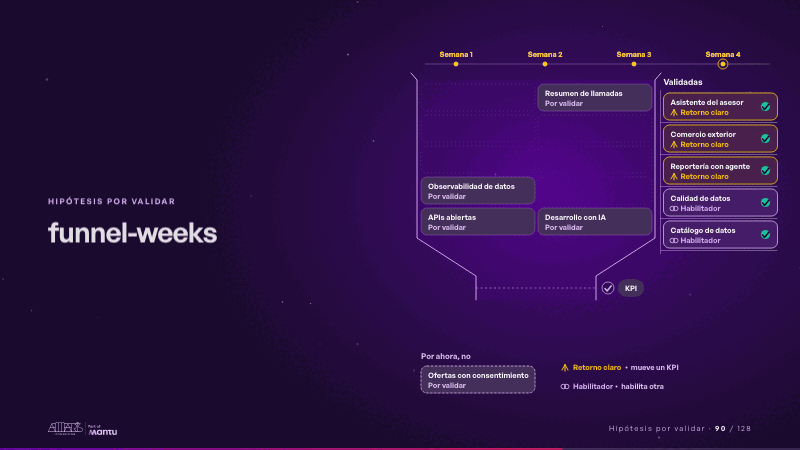
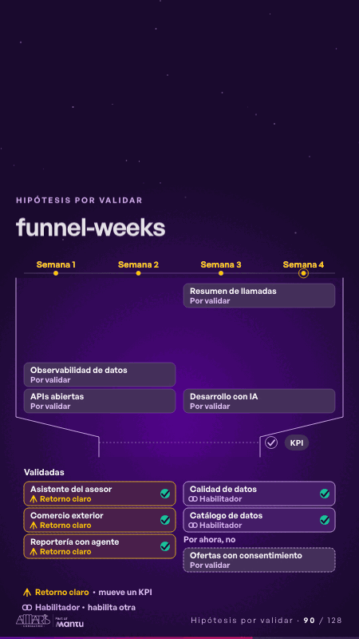

# funnel-weeks · Hipótesis por validar

 

## Qué cuenta

Diez candidatas caen en la boca de un embudo; arriba, un riel con las semanas; a la derecha, el estante «Validadas»; abajo, la bandeja «Por ahora, no».

## Cómo respira

Cada semana se encienden una o dos: bajan por el cuello, pasan un pequeño check de KPI que se pone verde y quedan en el estante con su etiqueta, «Retorno claro» o «Habilitador»; en la semana 2 una sigue sin check y descansa en «Por ahora, no». Queda: cinco validadas, una a un lado y cuatro esperando en el embudo.

## Cuándo usarla

Intención: **Hipótesis por validar** (hypotheses, process). Verticales: cualquiera. Layout `left`. Origen: dcd · escena de catálogo (banca). El snippet completo, listo para pegar en un storyboard: [`snippets/funnel-weeks.json`](../../snippets/funnel-weeks.json).

## Args

```json
{
 "layout": "left",
 "scene": "funnel-weeks",
 "args": {
  "candidates": [
   "‹como: Asistente del asesor›",
   "‹como: Resumen de llamadas›",
   "‹como: Comercio exterior›",
   "‹como: Reportería con agente›",
   "‹como: Calidad de datos›",
   "‹como: Catálogo de datos›",
   "‹como: Observabilidad de datos›",
   "‹como: Ofertas con consentimiento›",
   "‹como: APIs abiertas›",
   "‹como: Desarrollo con IA›"
  ],
  "weeks": [
   "‹como: Semana 1›",
   "‹como: Semana 2›",
   "‹como: Semana 3›",
   "‹como: Semana 4›"
  ],
  "route": [
   [
    0,
    0,
    0
   ],
   [
    2,
    0,
    0
   ],
   [
    3,
    1,
    0
   ],
   [
    7,
    1,
    -1
   ],
   [
    4,
    2,
    1
   ],
   [
    5,
    3,
    1
   ]
  ],
  "tags": [
   [
    "‹como: Retorno claro›",
    "‹como: mueve un KPI›"
   ],
   [
    "‹como: Habilitador›",
    "‹como: habilita otra›"
   ]
  ],
  "pending": "‹como: Por validar›",
  "kpi": "‹como: KPI›",
  "shelf": "‹como: Validadas›",
  "aside": "‹como: Por ahora, no›"
 }
}
```

## What it is

Hypotheses to validate scene, layout «left», for any decks. It lands at a glance, then breathes in a slow loop; its args (aside, candidates, kpi, pending, route, shelf, tags, weeks) carry every visible word, so the same scene serves a new client once the texts are rewritten.

## Relacionadas · Related

- [automation-stairs · El mecanismo: cómo cambiaría su operación](automation-stairs.md)
- [before-after-lanes · Antes y después](before-after-lanes.md)
- [before-after-split · Antes y después](before-after-split.md)
- [build-deliver · Formación: la demo en vivo](build-deliver.md)
- [delivery-cycle · El mecanismo: cómo cambiaría su operación](delivery-cycle.md)
- [discovery · Próximo paso: formas de empezar y discovery](discovery.md)

Fuente · source: [`scenes/story/banca_d07_10.py`](../../scenes/story/banca_d07_10.py) · sha256 `33beec2a7ad4`
