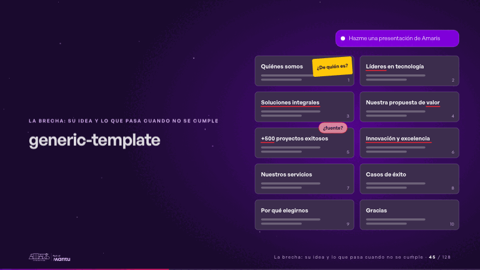
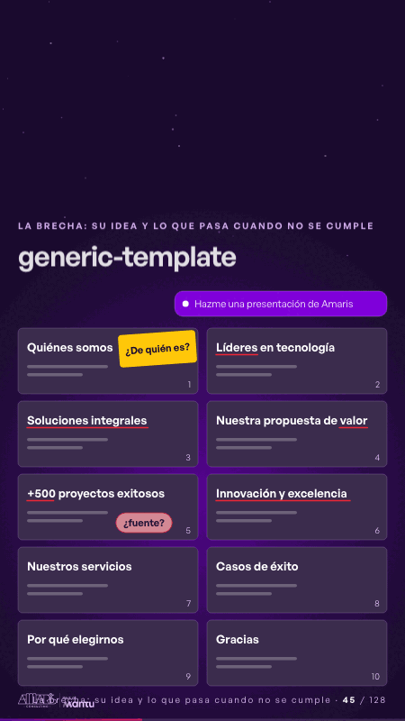

# generic-template · La brecha: su idea y lo que pasa cuando no se cumple

 

## Qué cuenta

Arriba, una línea en el chat: «Hazme una presentación de Amaris»; debajo, diez diapositivas grises con sus títulos.

## Cómo respira

Se subrayan una a una las frases que podría firmar cualquier consultora (líderes, soluciones integrales, valor, innovación y excelencia); la cifra sin fuente recibe «¿fuente?» y al final una etiqueta tapa el logo: «¿De quién es?». Cuadro final: todo lo genérico subrayado y el logo tapado.

## Cuándo usarla

Intención: **La brecha: su idea y lo que pasa cuando no se cumple** (gap). Verticales: formacion. Layout `left`. Origen: Clase VR (formación) · diapositiva «Pides una presentación y recibes la de todos». El snippet completo, listo para pegar en un storyboard: [`snippets/generic-template.json`](../../snippets/generic-template.json).

## Args

```json
{
 "layout": "left",
 "scene": "generic-template",
 "args": {
  "request": "‹como: Hazme una presentación de Amaris›",
  "generic": [
   {
    "t": "‹como: Quiénes somos›",
    "logo": "‹como: Logo›",
    "at": 0.66
   },
   {
    "t": "‹como: Líderes en tecnología›",
    "u": "‹como: Líderes›",
    "at": 0.22
   },
   {
    "t": "‹como: Soluciones integrales›",
    "u": "‹como: Soluciones integrales›",
    "at": 0.3
   },
   {
    "t": "‹como: Nuestra propuesta de valor›",
    "u": "‹como: valor›",
    "at": 0.38
   },
   {
    "t": "‹como: +500 proyectos exitosos›",
    "fig": "‹como: +500›",
    "at": 0.58
   },
   {
    "t": "‹como: Innovación y excelencia›",
    "u": "‹como: Innovación y excelencia›",
    "at": 0.46
   },
   {
    "t": "‹como: Nuestros servicios›"
   },
   {
    "t": "‹como: Casos de éxito›"
   },
   {
    "t": "‹como: Por qué elegirnos›"
   },
   {
    "t": "‹como: Gracias›"
   }
  ],
  "nosource": "‹como: ¿fuente?›",
  "whose": "‹como: ¿De quién es?›"
 }
}
```

## What it is

The gap scene, layout «left», for formacion decks. It lands at a glance, then breathes in a slow loop; its args (generic, nosource, request, whose) carry every visible word, so the same scene serves a new client once the texts are rewritten.

## Relacionadas · Related

- [client-worries · La brecha: su idea y lo que pasa cuando no se cumple](client-worries.md)
- [week-calendar · La brecha: su idea y lo que pasa cuando no se cumple](week-calendar.md)
- [before-after-split · Antes y después](before-after-split.md)
- [cascade · La brecha: su idea y lo que pasa cuando no se cumple](cascade.md)
- [funnel-stages · Embudo](funnel-stages.md)
- [journey-path · Recorrido](journey-path.md)

Fuente · source: [`scenes/story/formacion_s01_03.py`](../../scenes/story/formacion_s01_03.py) · sha256 `68ee479403f2`
