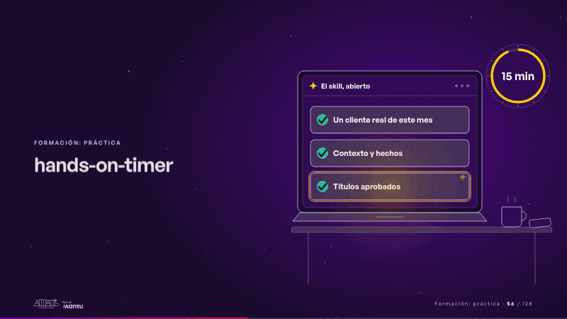
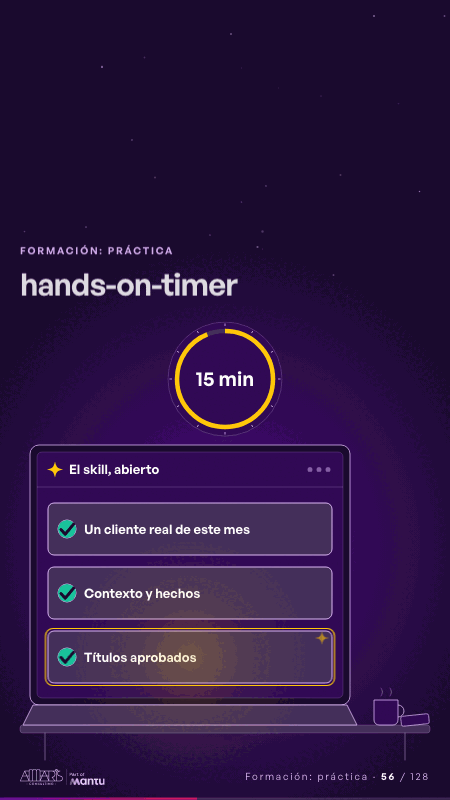

# hands-on-timer · Formación: práctica

 

## Qué cuenta

Un escritorio con el portátil abierto en el skill, tres pasos por marcar en la pantalla y, al lado, un reloj de 15 minutos.

## Cómo respira

El reloj se llena mientras los pasos se marcan en orden: «Un cliente real de este mes», «Contexto y hechos» y «Títulos aprobados», que queda resaltado.

## Cuándo usarla

Intención: **Formación: práctica** (hands-on). Verticales: formacion. Layout `left`. Origen: Clase VR (formación) · diapositiva «Tu próxima prospección, en quince minutos». El snippet completo, listo para pegar en un storyboard: [`snippets/hands-on-timer.json`](../../snippets/hands-on-timer.json).

## Args

```json
{
 "layout": "left",
 "scene": "hands-on-timer",
 "args": {
  "app": "‹como: El skill, abierto›",
  "steps": [
   "‹como: Un cliente real de este mes›",
   "‹como: Contexto y hechos›",
   "‹como: Títulos aprobados›"
  ],
  "timer": "‹como: 15 min›"
 }
}
```

## What it is

Training: hands-on scene, layout «left», for formacion decks. It lands at a glance, then breathes in a slow loop; its args (app, steps, timer) carry every visible word, so the same scene serves a new client once the texts are rewritten.

## Relacionadas · Related

- [pair-read · Formación: práctica](pair-read.md)
- [diagnostic · Formación: práctica](diagnostic.md)
- [build-deliver · Formación: la demo en vivo](build-deliver.md)
- [client-worries · La brecha: su idea y lo que pasa cuando no se cumple](client-worries.md)
- [facts-columns · Lo que sus equipos comparten: el dato](facts-columns.md)
- [generic-template · La brecha: su idea y lo que pasa cuando no se cumple](generic-template.md)

Fuente · source: [`scenes/story/formacion_s16_18.py`](../../scenes/story/formacion_s16_18.py) · sha256 `68e8f494ee34`
