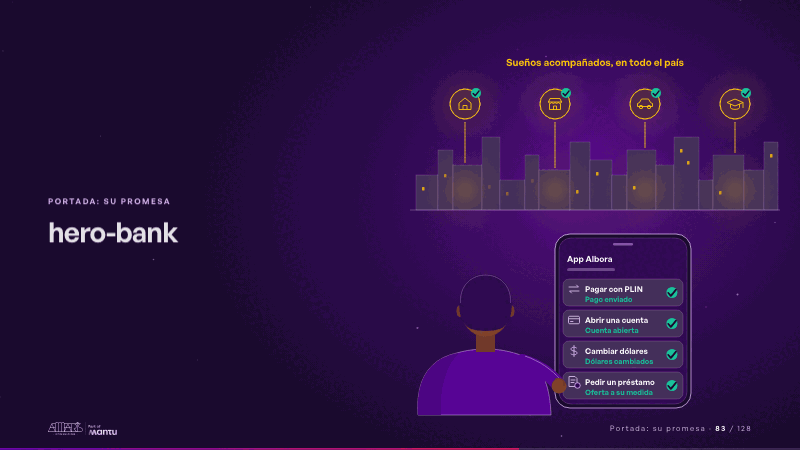
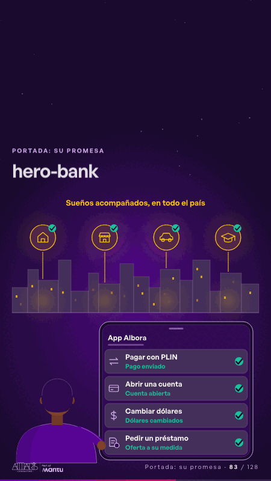

# hero-bank · Portada: su promesa

 

## Qué cuenta

Una ciudad al anochecer detrás de una persona, vista de espaldas, con la app del banco en la mano; sobre los techos esperan cuatro sueños apagados: una casa, un negocio, un auto y un birrete.

## Cómo respira

Pagar con PLIN, abrir una cuenta, cambiar dólares y pedir un préstamo se encienden por turnos en la app; cada uno recibe su respuesta con un check y la respuesta sube a su sueño, que se enciende sobre la ciudad. Queda: cuatro acciones respondidas y cuatro sueños encendidos.

## Cuándo usarla

Intención: **Portada: su promesa** (hero). Verticales: banca. Layout `left`. Origen: dcd · escena de catálogo (banca). El snippet completo, listo para pegar en un storyboard: [`snippets/hero-bank.json`](../../snippets/hero-bank.json).

## Args

```json
{
 "layout": "left",
 "scene": "hero-bank",
 "args": {
  "app": "‹como: App Albora›",
  "actions": [
   "‹como: Pagar con PLIN›",
   "‹como: Abrir una cuenta›",
   "‹como: Cambiar dólares›",
   "‹como: Pedir un préstamo›"
  ],
  "answers": [
   "‹como: Pago enviado›",
   "‹como: Cuenta abierta›",
   "‹como: Dólares cambiados›",
   "‹como: Oferta a su medida›"
  ],
  "region": "‹como: Sueños acompañados, en todo el país›"
 }
}
```

## What it is

Cover: their promise scene, layout «left», for banca decks. It lands at a glance, then breathes in a slow loop; its args (actions, answers, app, region) carry every visible word, so the same scene serves a new client once the texts are rewritten.

## Relacionadas · Related

- [repeat-story · La brecha: su idea y lo que pasa cuando no se cumple](repeat-story.md)
- [hypotheses-bank · Hipótesis por validar](hypotheses-bank.md)
- [ops-center · Cierre: su futuro, funcionando (el lema)](ops-center.md)
- [discovery · Próximo paso: formas de empezar y discovery](discovery.md)
- [criterion · El criterio: retorno o habilitador](criterion.md)
- [outside-business · Desde afuera: lo que vimos en fuentes públicas](outside-business.md)

Fuente · source: [`scenes/story/banca_s01_14.py`](../../scenes/story/banca_s01_14.py) · sha256 `f268b7f9fd00`
