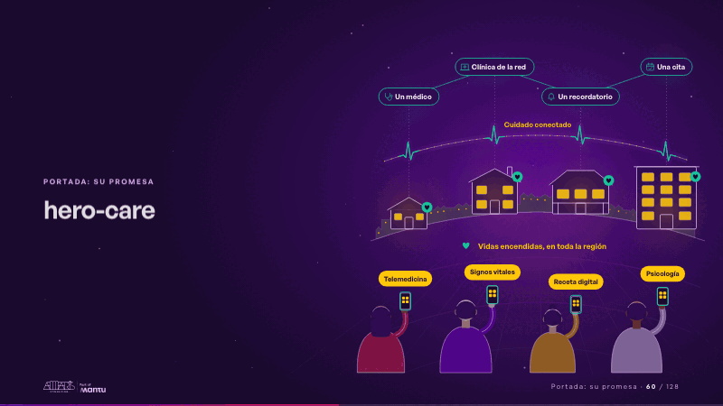
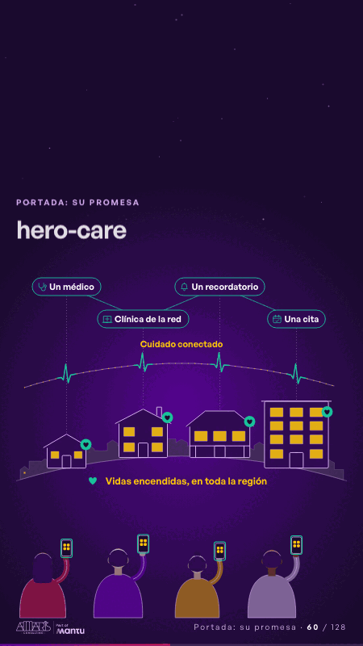

# hero-care · Portada: su promesa

 

## Qué cuenta

Una región al anochecer, vista detrás de cuatro personas con su teléfono: en el horizonte, sus casas y las de toda la región; arriba, un solo pulso del cuidado.

## Cómo respira

Cada consulta en la app sube por el pulso, abre el cuidado que la responde (un médico, una clínica de la red, un recordatorio, una cita) y baja como un corazón que enciende esa casa.

## Cuándo usarla

Intención: **Portada: su promesa** (hero). Verticales: salud. Layout `left`. Origen: dcd · escena de catálogo (salud). El snippet completo, listo para pegar en un storyboard: [`snippets/hero-care.json`](../../snippets/hero-care.json).

## Args

```json
{
 "layout": "left",
 "scene": "hero-care",
 "args": {
  "services": [
   "‹como: Telemedicina›",
   "‹como: Signos vitales›",
   "‹como: Receta digital›",
   "‹como: Psicología›"
  ],
  "cares": [
   "‹como: Un médico›",
   "‹como: Clínica de la red›",
   "‹como: Un recordatorio›",
   "‹como: Una cita›"
  ],
  "link": "‹como: Cuidado conectado›",
  "region": "‹como: Vidas encendidas, en toda la región›"
 }
}
```

## What it is

Cover: their promise scene, layout «left», for salud decks. It lands at a glance, then breathes in a slow loop; its args (cares, link, region, services) carry every visible word, so the same scene serves a new client once the texts are rewritten.

## Relacionadas · Related

- [repeat-story · La brecha: su idea y lo que pasa cuando no se cumple](repeat-story.md)
- [care-center · Cierre: su futuro, funcionando (el lema)](care-center.md)
- [hypotheses-care · Hipótesis por validar](hypotheses-care.md)
- [discovery · Próximo paso: formas de empezar y discovery](discovery.md)
- [criterion · El criterio: retorno o habilitador](criterion.md)
- [outside-business · Desde afuera: lo que vimos en fuentes públicas](outside-business.md)

Fuente · source: [`scenes/story/salud_s01_03.py`](../../scenes/story/salud_s01_03.py) · sha256 `9ab574cefe5b`
