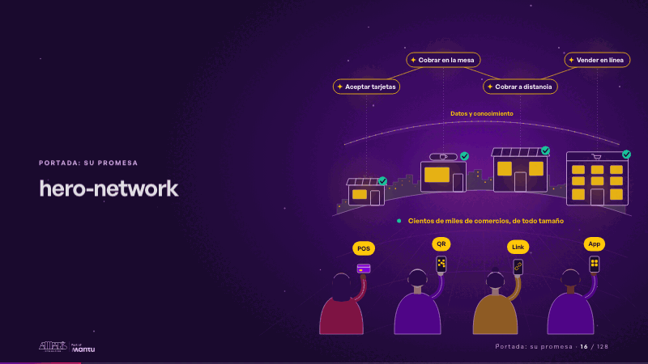
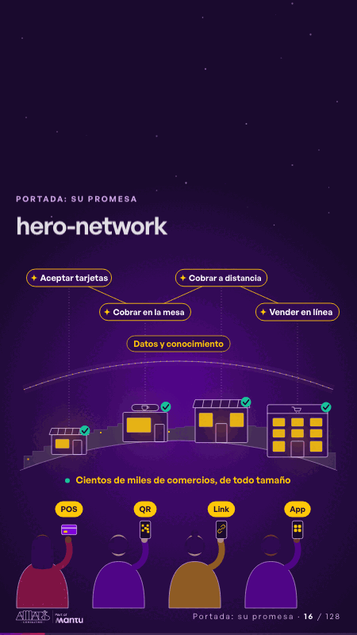

# hero-network · Portada: su promesa

 

## Qué cuenta

Una calle al anochecer, vista detrás de cuatro personas: en el horizonte, comercios de todo tamaño y, al fondo, cientos de pequeñas vitrinas encendidas; sobre los techos, un flujo de datos y conocimiento; arriba, una constelación apagada.

## Cómo respira

Cada persona paga (POS, QR, link o app), el comercio se enciende, el pago sube como dato, abre la oportunidad de ese comercio y el conocimiento baja como un visto verde: cada negocio avanza más rápido.

## Cuándo usarla

Intención: **Portada: su promesa** (hero). Verticales: pagos. Layout `left`. Origen: dcd · escena de catálogo (pagos). El snippet completo, listo para pegar en un storyboard: [`snippets/hero-network.json`](../../snippets/hero-network.json).

## Args

```json
{
 "layout": "left",
 "scene": "hero-network",
 "args": {
  "means": [
   "‹como: POS›",
   "‹como: QR›",
   "‹como: Link›",
   "‹como: App›"
  ],
  "opportunities": [
   "‹como: Aceptar tarjetas›",
   "‹como: Cobrar en la mesa›",
   "‹como: Cobrar a distancia›",
   "‹como: Vender en línea›"
  ],
  "link": "‹como: Datos y conocimiento›",
  "merchants": "‹como: Cientos de miles de comercios, de todo tamaño›"
 }
}
```

## What it is

Cover: their promise scene, layout «left», for pagos decks. It lands at a glance, then breathes in a slow loop; its args (link, means, merchants, opportunities) carry every visible word, so the same scene serves a new client once the texts are rewritten.

## Relacionadas · Related

- [repeat-story · La brecha: su idea y lo que pasa cuando no se cumple](repeat-story.md)
- [hypotheses-live-b · Hipótesis por validar](hypotheses-live-b.md)
- [tickets-live · Cierre: su futuro, funcionando (el lema)](tickets-live.md)
- [discovery · Próximo paso: formas de empezar y discovery](discovery.md)
- [criterion · El criterio: retorno o habilitador](criterion.md)
- [outside-business · Desde afuera: lo que vimos en fuentes públicas](outside-business.md)

Fuente · source: [`scenes/story/pagos_s01_03.py`](../../scenes/story/pagos_s01_03.py) · sha256 `826293d2c8e4`
