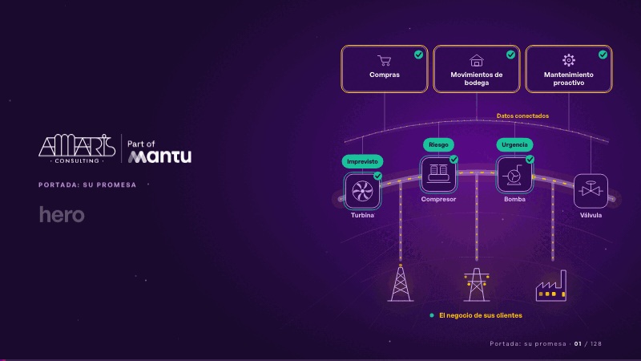
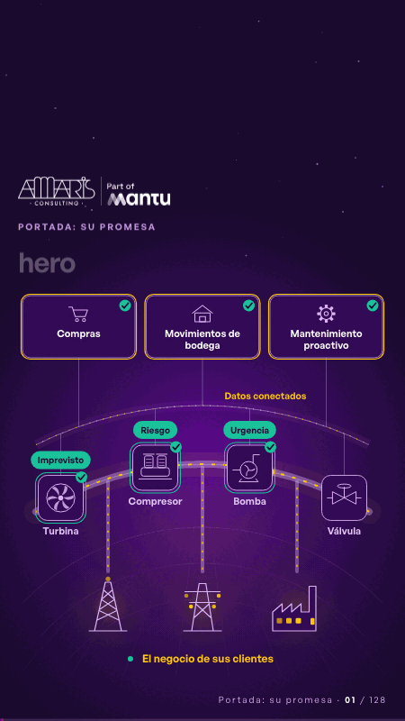

# hero · Portada: su promesa

 

## Qué cuenta

Se enciende una sola operación: arriba, las decisiones de negocio; en el horizonte, la línea de gas con turbina, compresor, bomba y válvula; abajo, el negocio de sus clientes con las luces encendidas.

## Cómo respira

Un imprevisto, una urgencia y un riesgo suben como señal a bodega, compras y mantenimiento, bajan como respuesta a tiempo, y el negocio de sus clientes nunca se apaga.

## Cuándo usarla

Intención: **Portada: su promesa** (hero). Verticales: energia. Layout `left`. Origen: dcd · escena de catálogo (energía). El snippet completo, listo para pegar en un storyboard: [`snippets/hero.json`](../../snippets/hero.json).

## Args

```json
{
 "layout": "left",
 "scene": "hero",
 "args": {
  "stations": [
   "‹como: Turbina›",
   "‹como: Compresor›",
   "‹como: Bomba›",
   "‹como: Válvula›"
  ],
  "decisions": [
   "‹como: Compras›",
   "‹como: Movimientos de bodega›",
   "‹como: Mantenimiento proactivo›"
  ],
  "events": [
   "‹como: Imprevisto›",
   "‹como: Urgencia›",
   "‹como: Riesgo›"
  ],
  "link": "‹como: Datos conectados›",
  "clients": "‹como: El negocio de sus clientes›"
 }
}
```

## What it is

Cover: their promise scene, layout «left», for energia decks. It lands at a glance, then breathes in a slow loop; its args (clients, decisions, events, link, stations) carry every visible word, so the same scene serves a new client once the texts are rewritten.

## Relacionadas · Related

- [cascade · La brecha: su idea y lo que pasa cuando no se cumple](cascade.md)
- [controlroom-live · Cierre: su futuro, funcionando (el lema)](controlroom-live.md)
- [hypotheses-live · Hipótesis por validar](hypotheses-live.md)
- [discovery · Próximo paso: formas de empezar y discovery](discovery.md)
- [outside · Desde afuera: lo que vimos en fuentes públicas](outside.md)
- [criterion · El criterio: retorno o habilitador](criterion.md)

Fuente · source: [`scenes/story/energia_s01_03.py`](../../scenes/story/energia_s01_03.py) · sha256 `6ec42dd92e1d`
