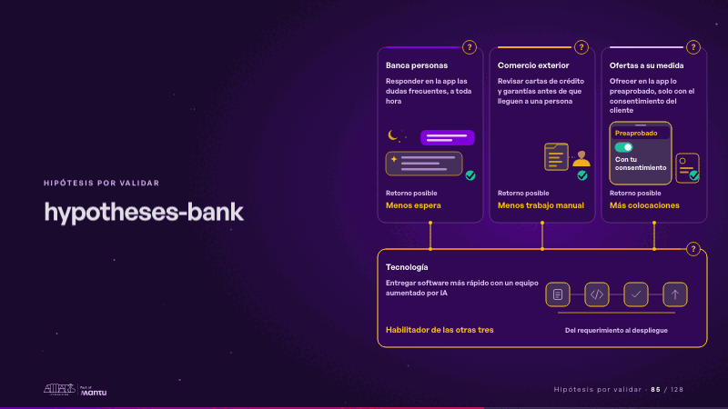
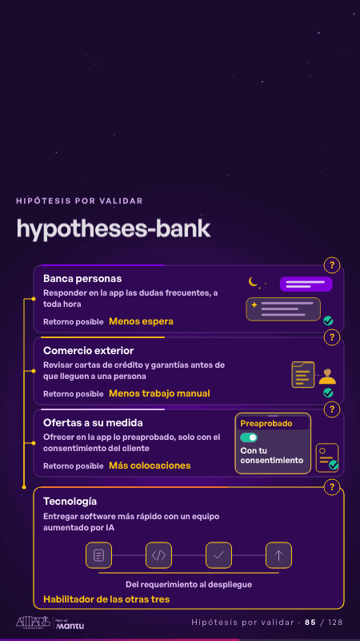

# hypotheses-bank · Hipótesis por validar

 

## Qué cuenta

Tres hipótesis con su retorno posible (banca personas, comercio exterior y ofertas a su medida) se apoyan en una cuarta, tecnología, que las habilita; cada tarjeta lleva su «?».

## Cómo respira

Cada tarjeta cobra vida por turnos: de noche, la duda del chat recibe su respuesta al instante; los documentos sueltos de comercio exterior se leen, se validan y llegan listos a una persona; en la app aparece un preaprobado, el cliente da su consentimiento y solo entonces llega la oferta, con su check; al final, tecnología recorre su ciclo y enciende las otras tres.

## Cuándo usarla

Intención: **Hipótesis por validar** (hypotheses). Verticales: banca. Layout `left`. Origen: dcd · escena de catálogo (banca). El snippet completo, listo para pegar en un storyboard: [`snippets/hypotheses-bank.json`](../../snippets/hypotheses-bank.json).

## Args

```json
{
 "layout": "left",
 "scene": "hypotheses-bank",
 "args": {
  "cards": [
   [
    "‹como: Banca personas›",
    "‹como: Responder en la app las dudas frecuentes, a toda hora›",
    "‹como: Menos espera›"
   ],
   [
    "‹como: Comercio exterior›",
    "‹como: Revisar cartas de crédito y garantías antes de que lleguen a una persona›",
    "‹como: Menos trabajo manual›"
   ],
   [
    "‹como: Ofertas a su medida›",
    "‹como: Ofrecer en la app lo preaprobado, solo con el consentimiento del cliente›",
    "‹como: Más colocaciones›"
   ],
   [
    "‹como: Tecnología›",
    "‹como: Entregar software más rápido con un equipo aumentado por IA›",
    "‹como: Habilitador de las otras tres›"
   ]
  ],
  "ret": "‹como: Retorno posible›",
  "cycle": "‹como: Del requerimiento al despliegue›",
  "offer": [
   "‹como: Preaprobado›",
   "‹como: Con tu consentimiento›"
  ]
 }
}
```

## What it is

Hypotheses to validate scene, layout «left», for banca decks. It lands at a glance, then breathes in a slow loop; its args (cards, cycle, offer, ret) carry every visible word, so the same scene serves a new client once the texts are rewritten.

## Relacionadas · Related

- [repeat-story · La brecha: su idea y lo que pasa cuando no se cumple](repeat-story.md)
- [criterion · El criterio: retorno o habilitador](criterion.md)
- [discovery · Próximo paso: formas de empezar y discovery](discovery.md)
- [hero-bank · Portada: su promesa](hero-bank.md)
- [ops-center · Cierre: su futuro, funcionando (el lema)](ops-center.md)
- [chain-tap · Diseño técnico por capas](chain-tap.md)

Fuente · source: [`scenes/story/banca_s01_14.py`](../../scenes/story/banca_s01_14.py) · sha256 `f268b7f9fd00`
