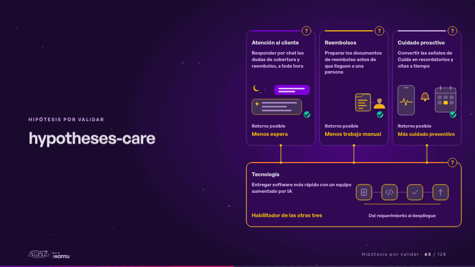
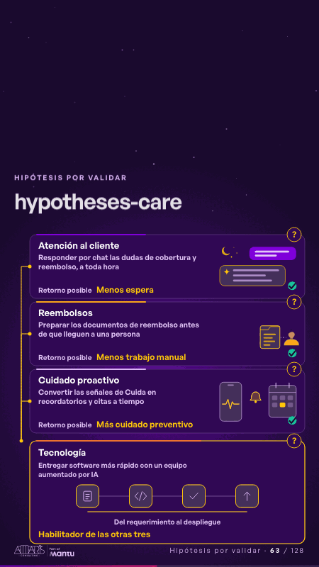

# hypotheses-care · Hipótesis por validar

 

## Qué cuenta

Tres hipótesis con su retorno posible (atención al cliente, reembolsos y cuidado proactivo) se apoyan en una cuarta, tecnología, que las habilita; cada tarjeta lleva su «?».

## Cómo respira

Cada tarjeta cobra vida por turnos: de noche, la duda del chat recibe su respuesta al instante; los documentos sueltos de un reembolso se leen, se validan y llegan listos a una persona; la señal de Cuida se vuelve recordatorio y cita en el calendario; al final, tecnología recorre su ciclo y enciende las otras tres.

## Cuándo usarla

Intención: **Hipótesis por validar** (hypotheses). Verticales: salud. Layout `left`. Origen: dcd · escena de catálogo (salud). El snippet completo, listo para pegar en un storyboard: [`snippets/hypotheses-care.json`](../../snippets/hypotheses-care.json).

## Args

```json
{
 "layout": "left",
 "scene": "hypotheses-care",
 "args": {
  "cards": [
   [
    "‹como: Atención al cliente›",
    "‹como: Responder por chat las dudas de cobertura y reembolso, a toda hora›",
    "‹como: Menos espera›"
   ],
   [
    "‹como: Reembolsos›",
    "‹como: Preparar los documentos de reembolso antes de que lleguen a una persona›",
    "‹como: Menos trabajo manual›"
   ],
   [
    "‹como: Cuidado proactivo›",
    "‹como: Convertir las señales de Cuida en recordatorios y citas a tiempo›",
    "‹como: Más cuidado preventivo›"
   ],
   [
    "‹como: Tecnología›",
    "‹como: Entregar software más rápido con un equipo aumentado por IA›",
    "‹como: Habilitador de las otras tres›"
   ]
  ],
  "ret": "‹como: Retorno posible›",
  "cycle": "‹como: Del requerimiento al despliegue›"
 }
}
```

## What it is

Hypotheses to validate scene, layout «left», for salud decks. It lands at a glance, then breathes in a slow loop; its args (cards, cycle, ret) carry every visible word, so the same scene serves a new client once the texts are rewritten.

## Relacionadas · Related

- [repeat-story · La brecha: su idea y lo que pasa cuando no se cumple](repeat-story.md)
- [criterion · El criterio: retorno o habilitador](criterion.md)
- [discovery · Próximo paso: formas de empezar y discovery](discovery.md)
- [care-center · Cierre: su futuro, funcionando (el lema)](care-center.md)
- [hero-care · Portada: su promesa](hero-care.md)
- [chain-tap · Diseño técnico por capas](chain-tap.md)

Fuente · source: [`scenes/story/salud_s07_14.py`](../../scenes/story/salud_s07_14.py) · sha256 `d97f63370815`
