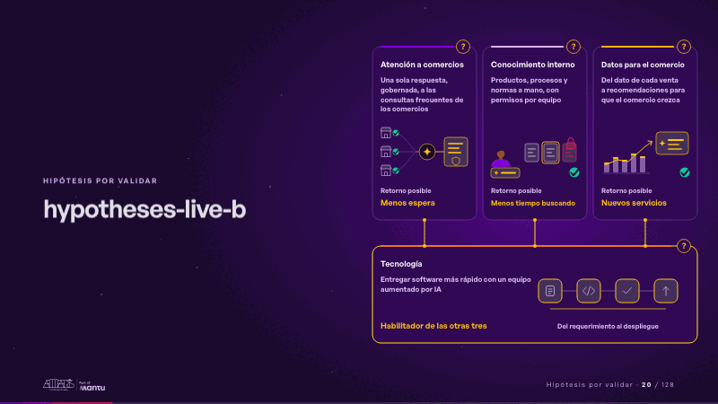
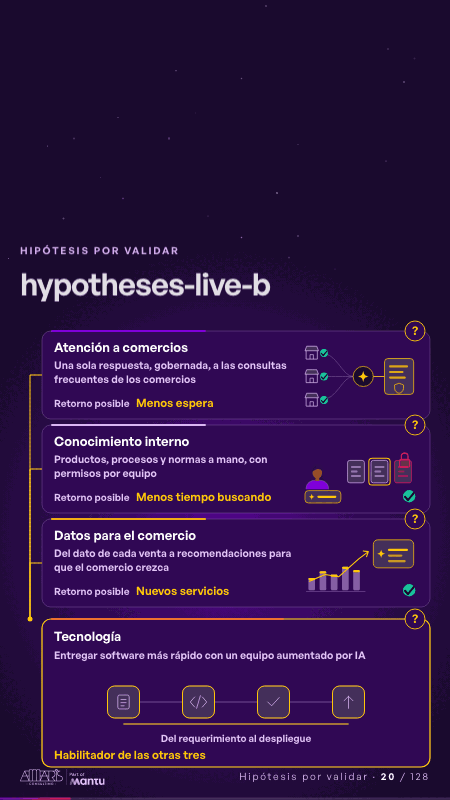

# hypotheses-live-b · Hipótesis por validar

 

## Qué cuenta

Tres hipótesis con su retorno posible se apoyan en una cuarta, tecnología, que las habilita; cada tarjeta lleva su «?».

## Cómo respira

El bucle recorre cada tarjeta y cuenta su historia: una sola respuesta llega a muchos comercios; el documento correcto vuelve a quien pregunta y el restringido sigue con candado; el dato de cada venta se vuelve una recomendación. Luego tecnología recorre su ciclo y enciende las otras tres.

## Cuándo usarla

Intención: **Hipótesis por validar** (hypotheses). Verticales: pagos, cualquiera. Layout `left`. Origen: dcd · escena de catálogo (pagos). El snippet completo, listo para pegar en un storyboard: [`snippets/hypotheses-live-b.json`](../../snippets/hypotheses-live-b.json).

## Args

```json
{
 "layout": "left",
 "scene": "hypotheses-live-b",
 "args": {
  "cards": [
   [
    "‹como: Atención a comercios›",
    "‹como: Una sola respuesta, gobernada, a las consultas frecuentes de los comercios›",
    "‹como: Menos espera›"
   ],
   [
    "‹como: Conocimiento interno›",
    "‹como: Productos, procesos y normas a mano, con permisos por equipo›",
    "‹como: Menos tiempo buscando›"
   ],
   [
    "‹como: Datos para el comercio›",
    "‹como: Del dato de cada venta a recomendaciones para que el comercio crezca›",
    "‹como: Nuevos servicios›"
   ],
   [
    "‹como: Tecnología›",
    "‹como: Entregar software más rápido con un equipo aumentado por IA›",
    "‹como: Habilitador de las otras tres›"
   ]
  ],
  "ret": "‹como: Retorno posible›",
  "cycle": "‹como: Del requerimiento al despliegue›"
 }
}
```

## What it is

Hypotheses to validate scene, layout «left», for pagos, any decks. It lands at a glance, then breathes in a slow loop; its args (cards, cycle, ret) carry every visible word, so the same scene serves a new client once the texts are rewritten.

## Relacionadas · Related

- [repeat-story · La brecha: su idea y lo que pasa cuando no se cumple](repeat-story.md)
- [criterion · El criterio: retorno o habilitador](criterion.md)
- [discovery · Próximo paso: formas de empezar y discovery](discovery.md)
- [hero-network · Portada: su promesa](hero-network.md)
- [tickets-live · Cierre: su futuro, funcionando (el lema)](tickets-live.md)
- [chain-tap · Diseño técnico por capas](chain-tap.md)

Fuente · source: [`scenes/story/pagos_s04_06.py`](../../scenes/story/pagos_s04_06.py) · sha256 `6ae7f109a628`
