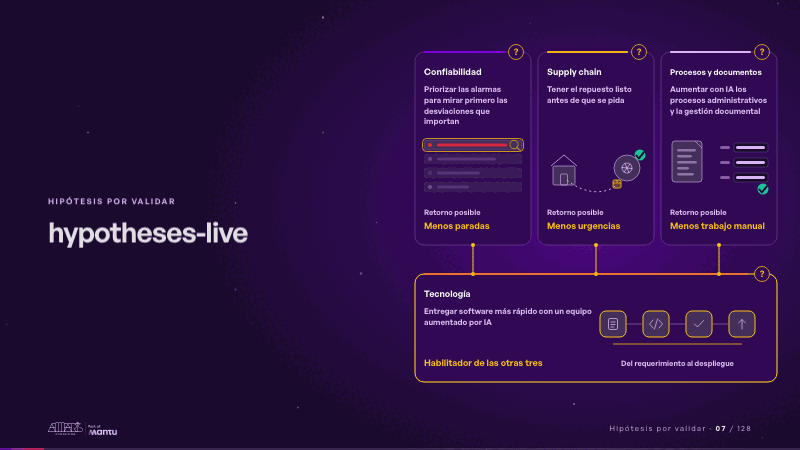
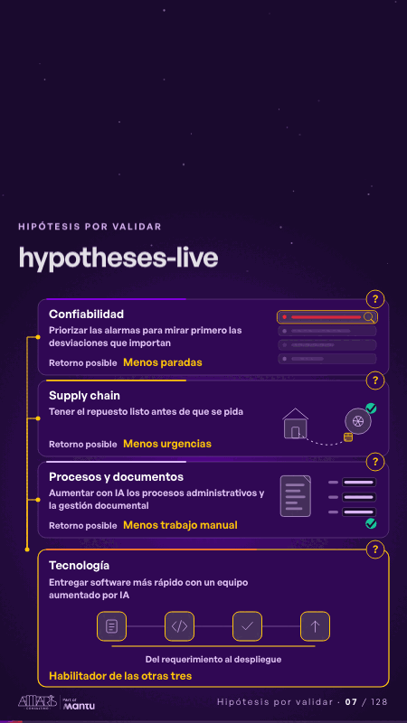

# hypotheses-live · Hipótesis por validar

 

## Qué cuenta

Tres hipótesis con su retorno posible se apoyan sobre una cuarta, tecnología, que las habilita; cada una con su «?».

## Cómo respira

Cada tarjeta cuenta su historia por turnos: la alarma que importa pasa primero, el repuesto llega antes del pedido, el documento llena su formulario, y el habilitador entrega y enciende a las otras tres.

## Cuándo usarla

Intención: **Hipótesis por validar** (hypotheses). Verticales: energia, cualquiera. Layout `left`. Origen: dcd · escena de catálogo (energía). El snippet completo, listo para pegar en un storyboard: [`snippets/hypotheses-live.json`](../../snippets/hypotheses-live.json).

## Args

```json
{
 "layout": "left",
 "scene": "hypotheses-live",
 "args": {
  "cards": [
   [
    "‹como: Confiabilidad›",
    "‹como: Priorizar las alarmas para mirar primero las desviaciones que importan›",
    "‹como: Menos paradas›"
   ],
   [
    "‹como: Supply chain›",
    "‹como: Tener el repuesto listo antes de que se pida›",
    "‹como: Menos urgencias›"
   ],
   [
    "‹como: Procesos y documentos›",
    "‹como: Aumentar con IA los procesos administrativos y la gestión documental›",
    "‹como: Menos trabajo manual›"
   ],
   [
    "‹como: Tecnología›",
    "‹como: Entregar software más rápido con un equipo aumentado por IA›",
    "‹como: Habilitador de las otras tres›"
   ]
  ],
  "ret": "‹como: Retorno posible›",
  "cycle": "‹como: Del requerimiento al despliegue›"
 }
}
```

## What it is

Hypotheses to validate scene, layout «left», for energia, any decks. It lands at a glance, then breathes in a slow loop; its args (cards, cycle, ret) carry every visible word, so the same scene serves a new client once the texts are rewritten.

## Relacionadas · Related

- [discovery · Próximo paso: formas de empezar y discovery](discovery.md)
- [criterion · El criterio: retorno o habilitador](criterion.md)
- [repeat-story · La brecha: su idea y lo que pasa cuando no se cumple](repeat-story.md)
- [hypotheses-quarter · Portada: su promesa](hypotheses-quarter.md)
- [tickets-live · Cierre: su futuro, funcionando (el lema)](tickets-live.md)
- [outside-business · Desde afuera: lo que vimos en fuentes públicas](outside-business.md)

Fuente · source: [`scenes/story/energia_s07_09.py`](../../scenes/story/energia_s07_09.py) · sha256 `502b3916baba`
