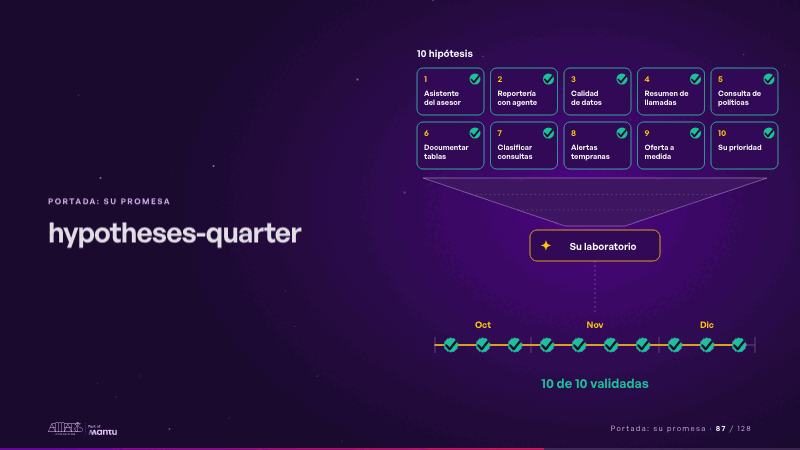
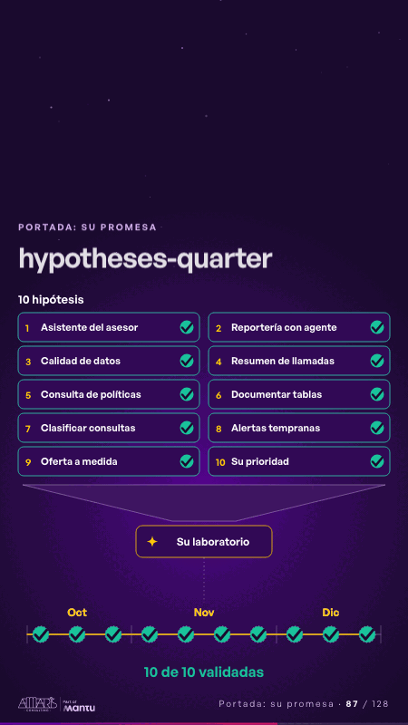

# hypotheses-quarter · Portada: su promesa

 

## Qué cuenta

Diez tarjetas de hipótesis, numeradas y cada una con su «?», sobre un embudo que baja a «Su laboratorio»; debajo, la línea del trimestre con octubre, noviembre y diciembre y diez casillas vacías. El contador es texto fijo: «10 hipótesis».

## Cómo respira

Un bucle de 12 segundos: una a una, cada hipótesis se enciende, baja por el embudo al laboratorio y sale validada; su «?» se vuelve check y un check cae en su casilla del trimestre, que se llena mes a mes hasta «10 de 10 validadas». Cuadro final: diez checks en la línea del trimestre.

## Cuándo usarla

Intención: **Portada: su promesa** (hero, hypotheses). Verticales: banca, cualquiera. Layout `left`. Origen: dcd · escena de catálogo (banca). El snippet completo, listo para pegar en un storyboard: [`snippets/hypotheses-quarter.json`](../../snippets/hypotheses-quarter.json).

## Args

```json
{
 "layout": "left",
 "scene": "hypotheses-quarter",
 "args": {
  "count": "‹como: 10 hipótesis›",
  "hypotheses": [
   "‹como: Asistente del asesor›",
   "‹como: Reportería con agente›",
   "‹como: Calidad de datos›",
   "‹como: Resumen de llamadas›",
   "‹como: Consulta de políticas›",
   "‹como: Documentar tablas›",
   "‹como: Clasificar consultas›",
   "‹como: Alertas tempranas›",
   "‹como: Oferta a medida›",
   "‹como: Su prioridad›"
  ],
  "lab": "‹como: Su laboratorio›",
  "months": [
   "‹como: Oct›",
   "‹como: Nov›",
   "‹como: Dic›"
  ],
  "pending": "‹como: Por validar›",
  "done": "‹como: 10 de 10 validadas›"
 }
}
```

## What it is

Cover: their promise scene, layout «left», for banca, any decks. It lands at a glance, then breathes in a slow loop; its args (count, done, hypotheses, lab, months, pending) carry every visible word, so the same scene serves a new client once the texts are rewritten.

## Relacionadas · Related

- [repeat-story · La brecha: su idea y lo que pasa cuando no se cumple](repeat-story.md)
- [hypotheses-live · Hipótesis por validar](hypotheses-live.md)
- [discovery · Próximo paso: formas de empezar y discovery](discovery.md)
- [tickets-live · Cierre: su futuro, funcionando (el lema)](tickets-live.md)
- [criterion · El criterio: retorno o habilitador](criterion.md)
- [outside-business · Desde afuera: lo que vimos en fuentes públicas](outside-business.md)

Fuente · source: [`scenes/story/banca_d01_06.py`](../../scenes/story/banca_d01_06.py) · sha256 `9deb39acebfb`
