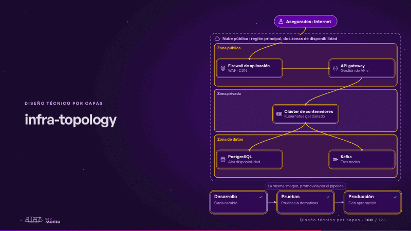
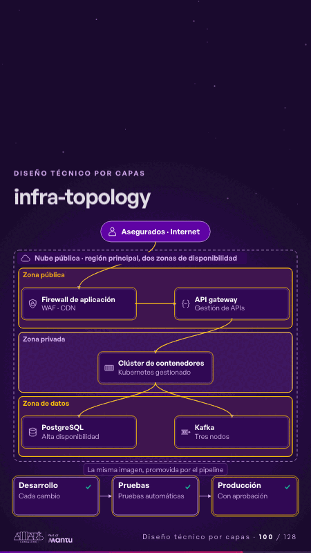

# infra-topology · Diseño técnico por capas

 

## Qué cuenta

La región en la nube con tres zonas de seguridad y sus nodos; abajo, desarrollo, pruebas y producción.

## Cómo respira

La solicitud entra desde internet y cruza cada zona encendiendo su borde; luego una versión viaja de desarrollo a producción.

## Cuándo usarla

Intención: **Diseño técnico por capas** (architecture, governance). Verticales: cualquiera. Layout `left`. Origen: Arquitectura demo (Aseguradora Andina, ficticia) · diapositiva «Tres zonas de seguridad y tres ambientes idénticos». El snippet completo, listo para pegar en un storyboard: [`snippets/infra-topology.json`](../../snippets/infra-topology.json).

## Args

```json
{
 "layout": "left",
 "scene": "infra-topology",
 "args": {
  "entry": "‹como: Asegurados · Internet›",
  "region": "‹como: Nube pública · región principal, dos zonas de disponibilidad›",
  "zones": [
   [
    "‹como: Zona pública›",
    "‹como: publica›",
    [
     [
      "‹como: waf›",
      "‹como: Firewall de aplicación›",
      "‹como: WAF · CDN›",
      "‹como: arquitectura/seguridad›"
     ],
     [
      "‹como: gw›",
      "‹como: API gateway›",
      "‹como: Gestión de APIs›",
      "‹como: arquitectura/api›"
     ]
    ]
   ],
   [
    "‹como: Zona privada›",
    "‹como: privada›",
    [
     [
      "‹como: k8s›",
      "‹como: Clúster de contenedores›",
      "‹como: Kubernetes gestionado›",
      "‹como: arquitectura/contenedor›"
     ]
    ]
   ],
   [
    "‹como: Zona de datos›",
    "‹como: datos›",
    [
     [
      "‹como: pg›",
      "‹como: PostgreSQL›",
      "‹como: Alta disponibilidad›",
      "‹como: arquitectura/base-datos›"
     ],
     [
      "‹como: kafka›",
      "‹como: Kafka›",
      "‹como: Tres nodos›",
      "‹como: arquitectura/cola›"
     ]
    ]
   ]
  ],
  "links": [
   [
    "‹como: waf›",
    "‹como: gw›",
    ""
   ],
   [
    "‹como: gw›",
    "‹como: k8s›",
    ""
   ],
   [
    "‹como: k8s›",
    "‹como: pg›",
    ""
   ],
   [
    "‹como: k8s›",
    "‹como: kafka›",
    ""
   ]
  ],
  "envs": [
   [
    "‹como: Desarrollo›",
    "‹como: Cada cambio›"
   ],
   [
    "‹como: Pruebas›",
    "‹como: Pruebas automáticas›"
   ],
   [
    "‹como: Producción›",
    "‹como: Con aprobación›"
   ]
  ],
  "promote": "‹como: La misma imagen, promovida por el pipeline›"
 }
}
```

## What it is

Layered technical design scene, layout «left», for any decks. It lands at a glance, then breathes in a slow loop; its args (entry, envs, links, promote, region, zones) carry every visible word, so the same scene serves a new client once the texts are rewritten.

## Relacionadas · Related

- [data-architecture · Diseño técnico por capas](data-architecture.md)
- [federated-live · Gobierno, permisos y control](federated-live.md)
- [adr-decisions · Diseño técnico por capas](adr-decisions.md)
- [arq-hero · Portada: su promesa](arq-hero.md)
- [automation-stairs · El mecanismo: cómo cambiaría su operación](automation-stairs.md)
- [c4-code · Diseño técnico por capas](c4-code.md)

Fuente · source: [`scenes/story/arquitectura.py`](../../scenes/story/arquitectura.py) · sha256 `01c6a4b3e10f`
