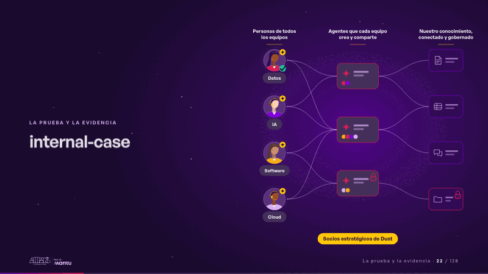
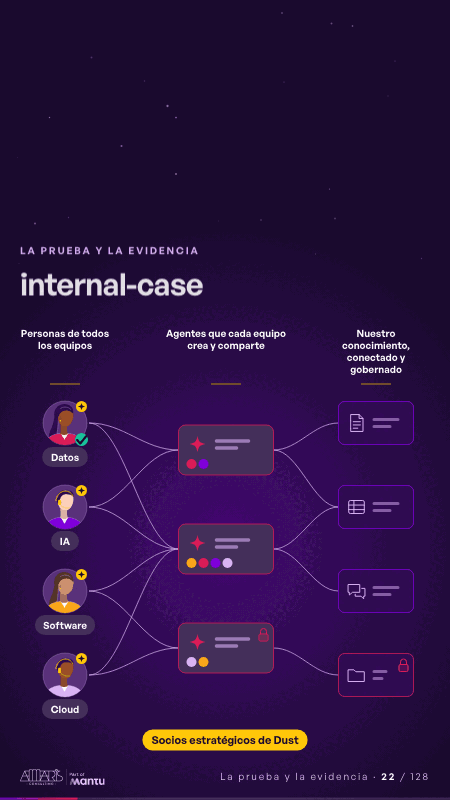

# internal-case · La prueba y la evidencia

 

## Qué cuenta

Tres columnas se arman (las personas de todos los equipos, cada una con su disciplina; los agentes que crean y comparten; y nuestro conocimiento, conectado y gobernado) y, al pie, el sello de socios estratégicos de Dust.

## Cómo respira

Software crea un agente, lo conecta a dos fuentes y lo comparte con Datos, IA y Cloud; Datos le pregunta y recibe la respuesta con su fuente; Cloud crea el suyo sobre la fuente restringida: el agente hereda su candado y solo lo ve quien tiene acceso a ese espacio.

## Cuándo usarla

Intención: **La prueba y la evidencia** (proof, who). Verticales: cualquiera. Layout `left`. Origen: dcd · escena de catálogo (pagos). El snippet completo, listo para pegar en un storyboard: [`snippets/internal-case.json`](../../snippets/internal-case.json).

## Args

```json
{
 "layout": "left",
 "scene": "internal-case",
 "args": {
  "people": "‹como: Personas de todos los equipos›",
  "agents": "‹como: Agentes que cada equipo crea y comparte›",
  "knowledge": "‹como: Nuestro conocimiento, conectado y gobernado›",
  "roles": [
   "‹como: Datos›",
   "‹como: IA›",
   "‹como: Software›",
   "‹como: Cloud›"
  ],
  "badge": "‹como: Socios estratégicos de Dust›"
 }
}
```

## What it is

Proof and evidence scene, layout «left», for any decks. It lands at a glance, then breathes in a slow loop; its args (agents, badge, knowledge, people, roles) carry every visible word, so the same scene serves a new client once the texts are rewritten.

## Relacionadas · Related

- [orbit · La prueba y la evidencia](orbit.md)
- [capacity-join · La prueba y la evidencia](capacity-join.md)
- [delivery-cycle · El mecanismo: cómo cambiaría su operación](delivery-cycle.md)
- [evidence · La prueba y la evidencia](evidence.md)
- [kpi-card · KPI y casos de éxito](kpi-card.md)
- [mondays-sent · La prueba y la evidencia](mondays-sent.md)

Fuente · source: [`scenes/story/pagos_s07_09.py`](../../scenes/story/pagos_s07_09.py) · sha256 `93755972a8cd`
