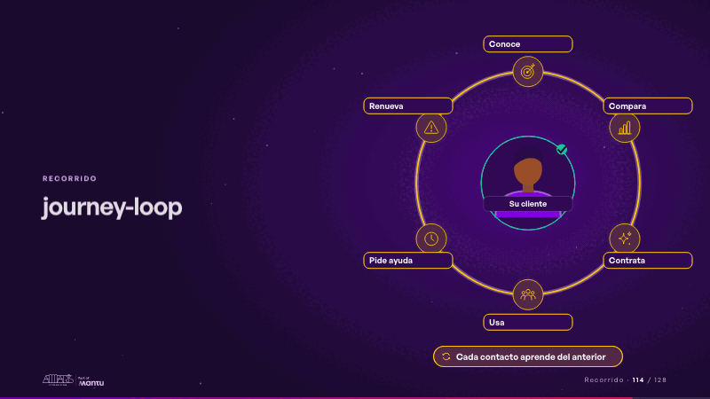
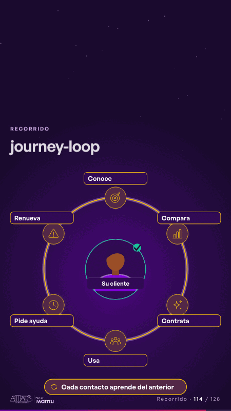

# journey-loop · Recorrido

 

## Qué cuenta

Su cliente al centro de un anillo con seis puntos de contacto, cada uno con un ícono de su sector y su nombre; abajo, la lección del ciclo.

## Cómo respira

Una chispa recorre el anillo una vez y deja su hilo encendido; cada punto de contacto se enciende a su paso y, al cerrar el anillo, el cliente del centro recibe su visto y se enciende la lección. Queda: el anillo cerrado, todo encendido.

## Cuándo usarla

Intención: **Recorrido** (journey, process). Verticales: cualquiera. Layout `left`. Origen: dcd 0.6.0 · escena de catálogo. El snippet completo, listo para pegar en un storyboard: [`snippets/journey-loop.json`](../../snippets/journey-loop.json).

## Args

```json
{
 "layout": "left",
 "scene": "journey-loop",
 "args": {
  "center": "‹como: Su cliente›",
  "touchpoints": [
   "‹como: Conoce›",
   "‹como: Compara›",
   "‹como: Contrata›",
   "‹como: Usa›",
   "‹como: Pide ayuda›",
   "‹como: Renueva›"
  ],
  "loop": "‹como: Cada contacto aprende del anterior›"
 }
}
```

## What it is

Journey scene, layout «left», for any decks. It lands at a glance, then breathes in a slow loop; its args (center, loop, touchpoints) carry every visible word, so the same scene serves a new client once the texts are rewritten.

## Relacionadas · Related

- [journey-path · Recorrido](journey-path.md)
- [automation-stairs · El mecanismo: cómo cambiaría su operación](automation-stairs.md)
- [before-after-lanes · Antes y después](before-after-lanes.md)
- [before-after-split · Antes y después](before-after-split.md)
- [build-deliver · Formación: la demo en vivo](build-deliver.md)
- [delivery-cycle · El mecanismo: cómo cambiaría su operación](delivery-cycle.md)

Fuente · source: [`scenes/story/intents_s01_08.py`](../../scenes/story/intents_s01_08.py) · sha256 `40167e45ae96`
