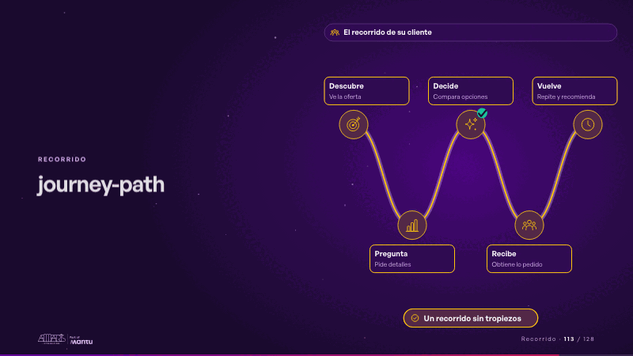
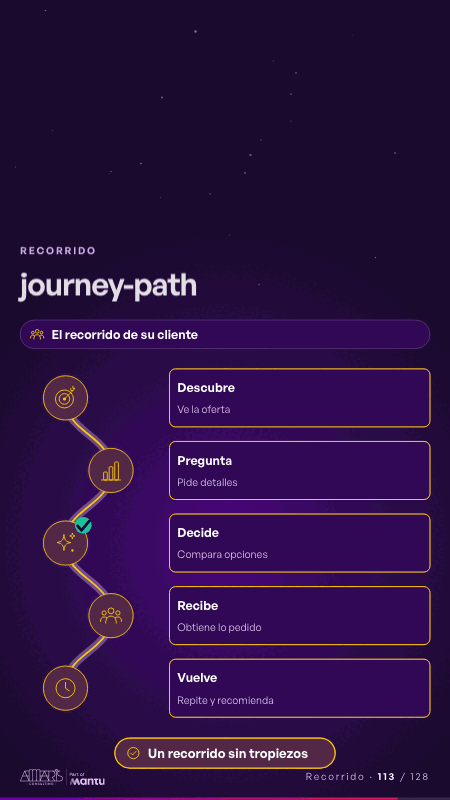

# journey-path · Recorrido

 

## Qué cuenta

Arriba, para quién es; debajo, el recorrido de su cliente en cinco estaciones con los íconos de su sector, cada una con su nombre y lo que pasa ahí; en una de ellas, un «?»; abajo, la promesa.

## Cómo respira

Un viajero recorre el camino y cada estación se enciende a su paso; en la estación de la fricción se detiene, el «?» se vuelve un visto y sigue hasta el final, donde se enciende la promesa. Queda: el recorrido encendido, la fricción resuelta.

## Cuándo usarla

Intención: **Recorrido** (journey, process, gap). Verticales: cualquiera. Layout `left`. Origen: dcd 0.6.0 · escena de catálogo. El snippet completo, listo para pegar en un storyboard: [`snippets/journey-path.json`](../../snippets/journey-path.json).

## Args

```json
{
 "layout": "left",
 "scene": "journey-path",
 "args": {
  "who": "‹como: El recorrido de su cliente›",
  "steps": [
   [
    "‹como: Descubre›",
    "‹como: Ve la oferta›"
   ],
   [
    "‹como: Pregunta›",
    "‹como: Pide detalles›"
   ],
   [
    "‹como: Decide›",
    "‹como: Compara opciones›"
   ],
   [
    "‹como: Recibe›",
    "‹como: Obtiene lo pedido›"
   ],
   [
    "‹como: Vuelve›",
    "‹como: Repite y recomienda›"
   ]
  ],
  "friction": 2,
  "friction_label": "‹como: ¿Dónde se detiene?›",
  "goal": "‹como: Un recorrido sin tropiezos›"
 }
}
```

## What it is

Journey scene, layout «left», for any decks. It lands at a glance, then breathes in a slow loop; its args (friction, friction_label, goal, steps, who) carry every visible word, so the same scene serves a new client once the texts are rewritten.

## Relacionadas · Related

- [before-after-split · Antes y después](before-after-split.md)
- [journey-loop · Recorrido](journey-loop.md)
- [automation-stairs · El mecanismo: cómo cambiaría su operación](automation-stairs.md)
- [before-after-lanes · Antes y después](before-after-lanes.md)
- [build-deliver · Formación: la demo en vivo](build-deliver.md)
- [cascade · La brecha: su idea y lo que pasa cuando no se cumple](cascade.md)

Fuente · source: [`scenes/story/intents_s01_08.py`](../../scenes/story/intents_s01_08.py) · sha256 `40167e45ae96`
